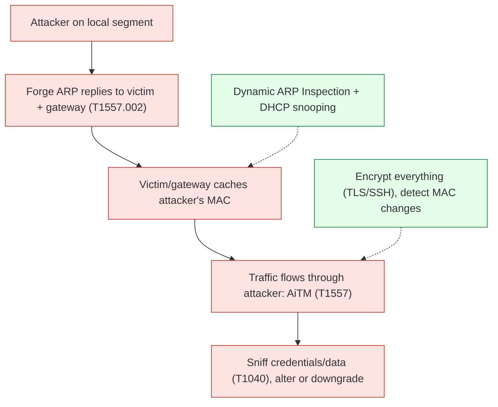

# ARP Poisoning and Man-in-the-Middle Attacks

## Summary

On a local network, hosts find each other's MAC addresses using ARP (Address Resolution Protocol), which has no authentication: a host believes any ARP reply it receives. An attacker on the same segment sends forged ARP replies so that traffic for the gateway (or another host) is delivered to the attacker instead, putting them in the middle of the conversation (adversary-in-the-middle, T1557, via ARP cache poisoning, T1557.002). From that position they can sniff credentials and data (T1040), alter traffic, or downgrade encryption. It works because Layer 2 trust is implicit.

## How the attack works

| Step | What happens |
|---|---|
| **Position** | Attacker is on the same broadcast domain (LAN/VLAN/Wi-Fi) as the victims |
| **Poison** | Forged ARP replies tell the victim "the gateway's MAC is mine" and tell the gateway "the victim's MAC is mine" |
| **Intercept** | Both sides now send their traffic to the attacker, who forwards it on to stay transparent |
| **Act** | Sniff plaintext, capture credentials, inject or modify content, or attempt TLS downgrade |

The same primitive underlies DNS spoofing, SSL-stripping and session hijacking once the attacker holds the middle position.

## Attack flow

## Detection

- A gateway or server IP suddenly mapping to a new MAC address, or one MAC claiming many IPs.
- Duplicate-IP or frequent ARP-reply storms on a segment.
- IDS signatures for gratuitous/unsolicited ARP replies (for example `arpwatch` alerts).
- TLS clients reporting certificate warnings, or unexpected downgrade to HTTP.

## Defense

- **Enable Dynamic ARP Inspection (DAI)** with DHCP snooping on managed switches, so the switch drops ARP replies that do not match a trusted IP-to-MAC binding.
- **Use port security** and 802.1X to control who connects to the segment.
- **Encrypt everything** (TLS, SSH, VPN) so a middle position yields ciphertext, not credentials, and enforce HSTS to resist downgrade.
- **Segment the network** to shrink each broadcast domain and the blast radius.
- **Monitor** ARP tables and MAC-to-IP changes, and alert on anomalies.

## ATT&CK mapping

| ID | Name | Tactic |
|---|---|---|
| T1557.002 | Adversary-in-the-Middle: ARP Cache Poisoning | Credential Access, Collection |
| T1557 | Adversary-in-the-Middle | Credential Access, Collection |
| T1040 | Network Sniffing | Credential Access, Discovery |

## Explanation

ARP is a room where everyone shouts "who has the address for the exit?" and believes whoever answers first. An attacker simply shouts "I'm the exit" louder and more often, so everyone hands their letters to them on the way out. The attacker reads each letter and passes it along, and nobody notices. The fix is a doorkeeper (Dynamic ARP Inspection) who checks that the person claiming to be the exit actually is, and sealing every letter (encryption) so a snoop in the middle learns nothing.
