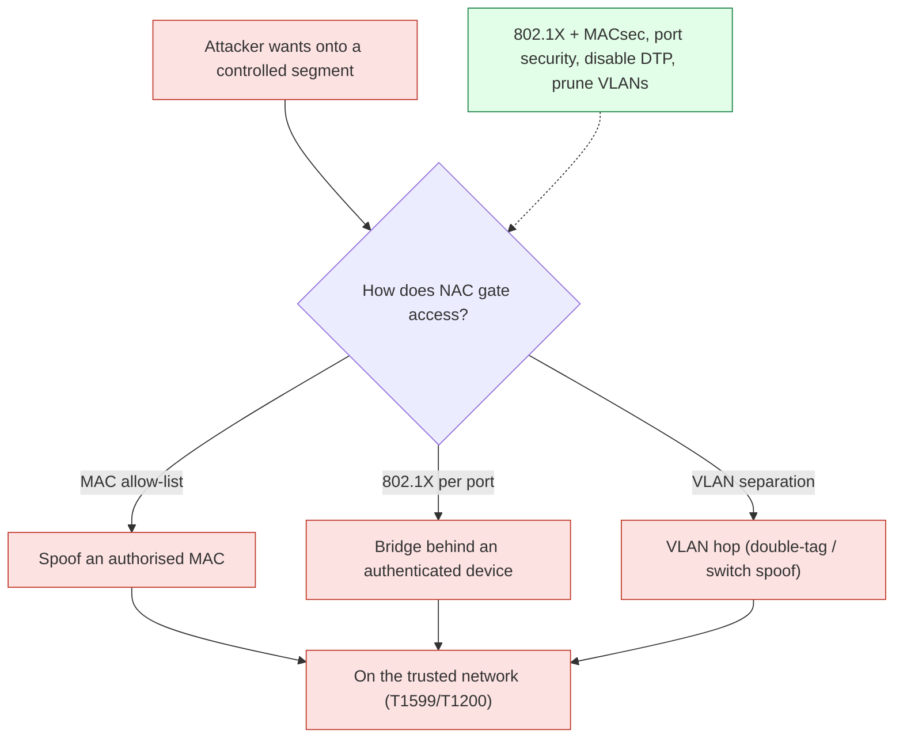

# Bypassing Network Access Control

## Summary

Network Access Control (NAC) decides which devices may connect to a network and what they may reach, typically using 802.1X authentication, MAC filtering, or posture checks. Attackers bypass NAC to get an unauthorised device onto a trusted segment: by impersonating an already-authorised device, by abusing a device that has passed the check, or by tunnelling past the boundary (network boundary bridging, T1599; a planted device is a hardware addition, T1200). The weakness is usually that NAC authenticates a port or a MAC once, not the traffic continuously.

## Common bypass techniques

| Technique | How it defeats NAC |
|---|---|
| **MAC spoofing** | Clone the MAC of an allowed device (printer, phone) that NAC trusts |
| **Hub/bridge behind an authorised host** | Piggyback on a device that already authenticated via 802.1X, riding its authorised port |
| **Rogue device / implant** | Plant a small device (drop box) on the network, authorised or bridging (T1200) |
| **VLAN hopping** | Switch spoofing or double tagging to reach VLANs the port should not |
| **Boundary bridging** | Pivot a compromised multi-homed host to bridge two networks (T1599) |
| **Captive-portal / pre-auth abuse** | Exploit services reachable before authentication completes |

## Attack flow

## Detection

- A known MAC appearing on an unexpected switch port, or two ports claiming the same MAC.
- 802.1X sessions where traffic characteristics change after authentication (a bridge behind the endpoint).
- Unexpected tagged frames, DTP negotiation, or traffic crossing VLAN boundaries.
- New or unknown devices on segments with a fixed, inventoried device set.

## Defense

- **Use 802.1X with per-session keying (MACsec)** rather than MAC allow-lists, which are trivially spoofed.
- **Enable port security**: limit MACs per port, and shut or alert on violations.
- **Harden switching**: disable DTP/auto-trunking, set unused ports to an unused VLAN, prune allowed VLANs on trunks, and change the native VLAN to prevent double-tagging.
- **Add continuous posture and behaviour checks**, not just one-time authentication at connect.
- **Physically secure ports** and inventory devices so a drop box stands out.

## ATT&CK mapping

| ID | Name | Tactic |
|---|---|---|
| T1599 | Network Boundary Bridging | Defense Impairment |
| T1200 | Hardware Additions | Initial Access |

## Explanation

NAC is a guard who checks ID at the door. The trouble is many NAC setups check the ID once and then trust the doorway forever. Attackers exploit that: wear a copied badge (MAC spoofing), walk in behind someone who already showed theirs (bridging behind an authenticated device), or find a connecting corridor the guard does not watch (VLAN hopping). The stronger guard checks not just the badge at the door but keeps verifying the person at the table (802.1X with MACsec and continuous posture), and walls off the corridors.
