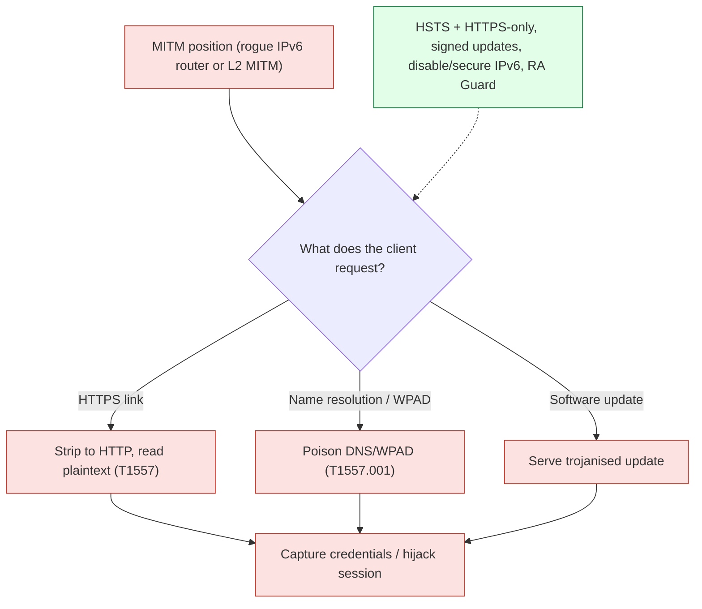

# HTTP Downgrade, Evil Update and IPv6 Attacks

## Summary

These are man-in-the-middle techniques that exploit how clients choose a channel or a source of truth. **HTTP downgrade (SSL stripping)** keeps a victim on plaintext HTTP so their traffic stays readable. **Evil update** feeds a client a malicious software update or installer over an unauthenticated channel. **IPv6 attacks** abuse the fact that IPv6 is often enabled but unmanaged: an attacker advertises themselves as the IPv6 router or DNS server and silently becomes the middle of the network (adversary-in-the-middle, T1557; name resolution poisoning, T1557.001). All three turn "the client trusted the network" into compromise.

## The three techniques

| Technique | Mechanism |
|---|---|
| **HTTP downgrade / SSL strip** | MITM rewrites HTTPS links to HTTP, so the victim-to-attacker leg is plaintext while the attacker speaks HTTPS to the server |
| **Evil update** | The attacker, in the middle, answers an update/installer request with a trojanised payload the client installs |
| **IPv6 rogue router (mitm6-style)** | Attacker sends Router Advertisements / replies to DHCPv6, becoming the victim's IPv6 DNS/gateway on a dual-stack LAN |
| **WPAD over IPv6** | The rogue DNS answers the victim's proxy-autodiscovery (WPAD) query, routing web traffic through the attacker |

IPv6 attacks are potent because many networks deploy IPv4 controls but leave IPv6 on with no equivalent protection, so the attacker wins an uncontested second network.

## Attack flow

## Detection

- Unexpected Router Advertisements or DHCPv6 replies from non-infrastructure hosts (RA Guard / DHCPv6 Guard alerts).
- Clients resolving names via an unapproved IPv6 DNS server, or WPAD queries being answered on networks that do not use WPAD.
- HTTPS sessions silently becoming HTTP, or certificate warnings spiking.
- Update clients fetching installers over unauthenticated channels or from unexpected hosts.

## Defense

- **Enforce HTTPS everywhere** with HSTS (ideally preloaded) so there is no plaintext leg to strip.
- **Sign and verify all software updates**, and deliver them over authenticated TLS; never trust an unsigned update.
- **Manage IPv6 as a first-class network**: disable it where unused, and where used enable **RA Guard** and **DHCPv6 Guard** on switches to block rogue routers.
- **Disable WPAD** if not needed, and never auto-discover proxies on untrusted networks.
- **Segment and monitor** both IP stacks with equal rigour.

## ATT&CK mapping

| ID | Name | Tactic |
|---|---|---|
| T1557 | Adversary-in-the-Middle | Credential Access, Collection |
| T1557.001 | Adversary-in-the-Middle: Name Resolution Poisoning and SMB Relay | Credential Access, Collection |

## Explanation

A client on a network trusts the network to tell it where things are and what is safe. These attacks abuse that trust at three points: telling the client "use the open plain road, not the armoured one" (downgrade), "here is your software update" when it is not (evil update), and — on networks that left a second door (IPv6) unguarded — "I am the way out" (rogue router). The defences are to armour every road and refuse the plain one (HSTS), seal every update with a signature, and guard the second door as carefully as the first.
