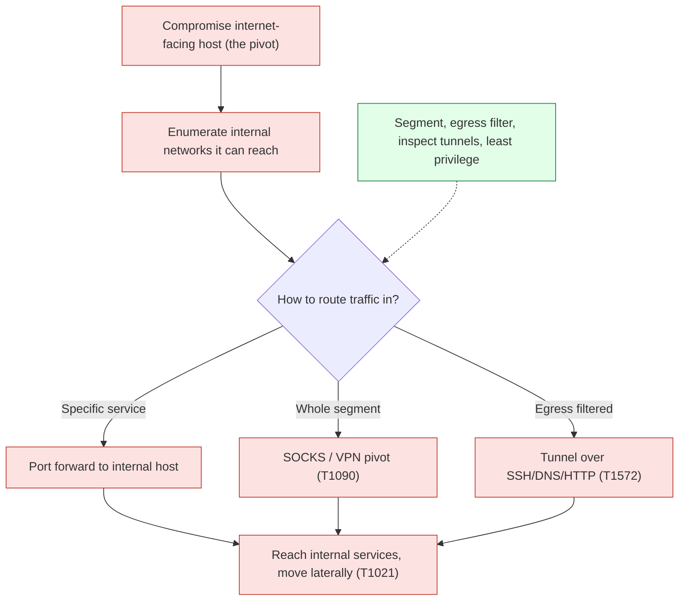

# Pivoting and Network Tunnelling

## Summary

After compromising one host, an attacker rarely finds their final target on that same machine. **Pivoting** uses the compromised host as a stepping stone to reach networks it can see but the attacker cannot — internal segments behind a firewall. **Tunnelling** wraps that traffic inside an allowed protocol (SSH, HTTP, DNS) so it crosses boundaries and evades egress filtering (protocol tunneling, T1572; proxying through the pivot, T1090; reusing remote services, T1021). The compromised host becomes a relay into the protected interior.

## Pivoting methods

| Method | What it does |
|---|---|
| **Port forwarding** | Map a port on the pivot to a service on an internal host (local/remote forward) |
| **SOCKS proxy** | Turn the pivot into a general proxy so tools reach the whole internal network (T1090) |
| **SSH tunnelling** | Use SSH local/remote/dynamic forwards to carry arbitrary traffic over an encrypted channel |
| **Protocol tunnelling** | Encapsulate traffic in DNS, HTTP(S) or ICMP to slip past egress controls (T1572) |
| **VPN pivot** | Establish a layer-3 tunnel for full routed access into the segment |

Chaining pivots ("double pivot") lets an attacker reach networks several hops deep from their entry point.

## Attack flow

## Detection

- A server initiating outbound connections it never normally makes, or long-lived encrypted sessions to unusual destinations.
- DNS or ICMP traffic with abnormal volume, entropy or record sizes (tunnelling signature).
- An internal host suddenly acting as a relay: many short connections to other internal hosts fanning out from one source.
- SSH sessions with dynamic/remote forwarding enabled on systems where that is not expected.

## Defense

- **Segment the network** so a single compromised host cannot see sensitive interior systems.
- **Filter egress**: allow only required outbound destinations and protocols, and inspect DNS and HTTP for tunnelling.
- **Restrict and monitor administrative protocols** (SSH, RDP, SMB) and disable forwarding features where not needed.
- **Apply least privilege** to service accounts so a pivot cannot authenticate onward.
- **Hunt for relay behaviour** and anomalous internal east-west traffic, not just inbound attacks.

## ATT&CK mapping

| ID | Name | Tactic |
|---|---|---|
| T1572 | Protocol Tunneling | Command and Control |
| T1090 | Proxy | Command and Control |
| T1021 | Remote Services | Lateral Movement |

## Explanation

Breaking into a building's lobby does not give you the vault; the vault is on a floor with no public lift. Pivoting is using a staff member you have compromised in the lobby to carry your messages to the upper floors and bring back replies. Tunnelling is hiding those messages inside ordinary-looking internal mail (DNS or HTTPS) so the floor guards wave them through. The defence is to wall off the floors from each other, inspect even the ordinary mail leaving the building, and give each staff member keys to as little as possible.
