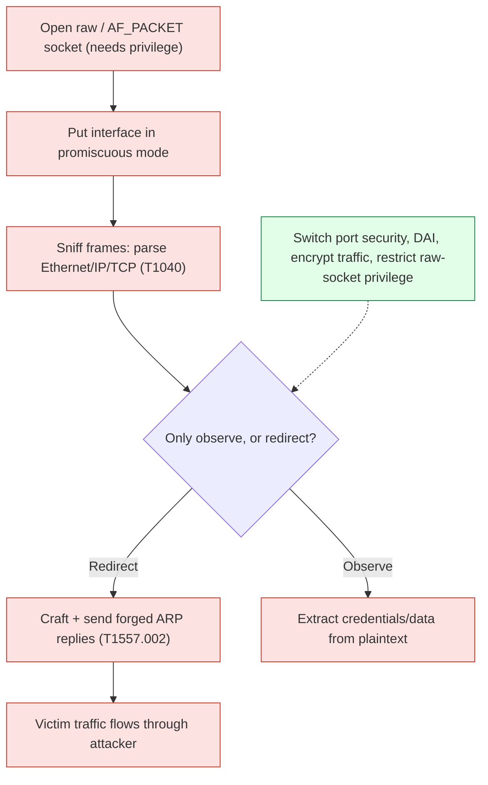

# Python Raw Sockets, Sniffing and Layer-2 Attacks

## Summary

Most programs use the operating system's high-level sockets, which hide packet headers. **Raw sockets** (and libraries such as Scapy) let a program read and craft packets field by field, down to Ethernet and ARP. This is how custom sniffers, scanners and spoofing tools are built, and it is the practical basis for Layer-2 attacks: sniffing traffic off the wire (T1040) and forging ARP to redirect it (ARP cache poisoning, T1557.002). The same capability powers defensive tooling — bespoke capture, parsing and detection scripts.

## What raw access enables

| Capability | Use |
|---|---|
| **Packet sniffing** | Read frames/packets off an interface, often in promiscuous mode, to inspect traffic (T1040) |
| **Packet crafting** | Build arbitrary headers to test parsers, spoof sources, or probe behaviour |
| **ARP spoofing** | Emit forged ARP replies to poison caches and redirect traffic (T1557.002) |
| **Custom scanners** | Send tailored SYN/other probes and interpret raw responses |
| **Protocol fuzzing** | Mutate fields at will to find implementation bugs |

Raw sockets usually require elevated privileges, since they bypass the normal network stack's protections.

## How a Layer-2 attack is built

## Detection

- Interfaces entering promiscuous mode on hosts that should not be capturing (some OSes log this).
- The ARP and sniffing indicators described in [ARP Poisoning and MITM](arp-poisoning-and-man-in-the-middle-attacks.md): changing IP-to-MAC bindings, ARP storms.
- Unexpected processes holding raw/`AF_PACKET` sockets or `CAP_NET_RAW` capability.
- Crafted packets with impossible or inconsistent header combinations reaching IDS.

## Defense

- **Encrypt traffic** (TLS, SSH, VPN) so sniffing yields ciphertext regardless of position.
- **Protect Layer 2**: switch port security, Dynamic ARP Inspection and DHCP snooping, as for ARP poisoning.
- **Restrict raw-socket privilege**: raw sockets need root or `CAP_NET_RAW`; limit which accounts and containers hold it, and monitor for its use.
- **Monitor for promiscuous interfaces** and anomalous locally generated traffic.
- Use the same capability defensively: build capture and detection scripts to watch your own segments.

## ATT&CK mapping

| ID | Name | Tactic |
|---|---|---|
| T1040 | Network Sniffing | Credential Access, Discovery |
| T1557.002 | Adversary-in-the-Middle: ARP Cache Poisoning | Credential Access, Collection |

## Explanation

Normal programs get network data like a letter already opened and summarised. Raw sockets hand you the sealed envelope with every stamp and address intact, and let you mail your own envelopes with any return address you like. That power builds honest tools (a custom traffic monitor) and dishonest ones (a sniffer that forges ARP to steer the mailroom through your desk). The defences are the Layer-2 controls that catch the forged addresses, encryption that makes a read envelope useless, and limiting who is allowed to handle raw mail at all.
