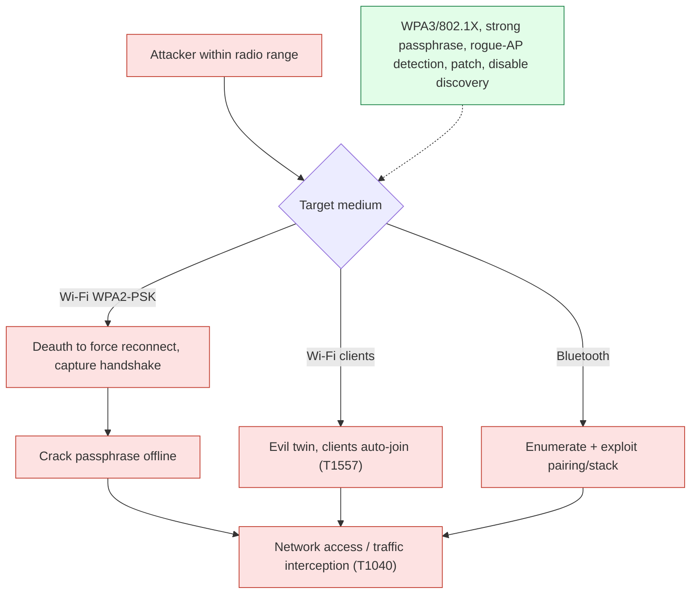

# Wi-Fi and Bluetooth Attacks

## Summary

Wireless links broadcast into the air, so an attacker nearby needs no physical connection to listen or interfere. **Wi-Fi attacks** capture authentication handshakes to crack passphrases, stand up rogue/evil-twin access points to lure clients, and sniff or inject frames (network sniffing, T1040; adversary-in-the-middle via a rogue AP, T1557). **Bluetooth attacks** target discovery, pairing and vulnerable stacks on phones, peripherals and IoT. The common theme is that radio is a shared medium an attacker can join from a distance, and a rogue radio device is itself an unauthorised addition to the environment (T1200).

## Representative techniques

| Area | Technique |
|---|---|
| **Wi-Fi handshake capture** | Capture the WPA2 4-way handshake (or PMKID) and crack the passphrase offline |
| **Evil twin / rogue AP** | Broadcast a familiar SSID so clients auto-connect, then MITM them (T1557) |
| **Deauthentication** | Spoofed deauth frames knock clients off to force reconnection/handshake capture |
| **Open/weak network sniffing** | Passive capture of unencrypted or weakly encrypted traffic (T1040) |
| **Bluetooth discovery/recon** | Enumerate discoverable devices, services and stack versions |
| **Pairing/stack abuse** | Exploit weak pairing or vulnerable Bluetooth/BLE implementations on a target device |

WPA3 and modern Bluetooth pairing close many of these, but legacy configurations and pre-shared keys remain widespread.

## Attack flow

## Detection

- Floods of deauthentication/disassociation frames, or clients repeatedly dropping and reconnecting.
- Two access points broadcasting the same SSID with different BSSIDs, or an AP in an unexpected location (rogue/evil twin).
- Wireless IDS alerts on unknown BSSIDs, spoofed MACs, or clients connecting to unmanaged APs.
- Unexpected Bluetooth discovery scans, or devices left discoverable that should not be.

## Defense

- **Use WPA3**, or WPA2-Enterprise with 802.1X so there is no shared passphrase to crack; if PSK is unavoidable, use a long random passphrase.
- **Enable Protected Management Frames (802.11w)** to blunt deauthentication attacks.
- **Deploy wireless IDS / rogue-AP detection** and investigate duplicate SSIDs.
- **Educate clients** not to auto-join open or familiar-named networks, and disable auto-connect to open SSIDs.
- **Bluetooth**: keep devices non-discoverable, use modern pairing (LE Secure Connections), remove stale pairings, and patch device firmware.

## ATT&CK mapping

| ID | Name | Tactic |
|---|---|---|
| T1040 | Network Sniffing | Credential Access, Discovery |
| T1557 | Adversary-in-the-Middle | Credential Access, Collection |
| T1200 | Hardware Additions | Initial Access |

## Explanation

A wired network is a conversation in a sealed room; wireless is the same conversation shouted across a courtyard. Anyone in the courtyard can listen (sniffing), can imitate the café everyone trusts so people sit at their table instead (evil twin), or can jostle someone until they re-announce the day's password (deauth plus handshake capture). The defences are to speak in a cipher only the right people share (WPA3/802.1X), make shouting the password pointless, and post a lookout for impostor cafés.
