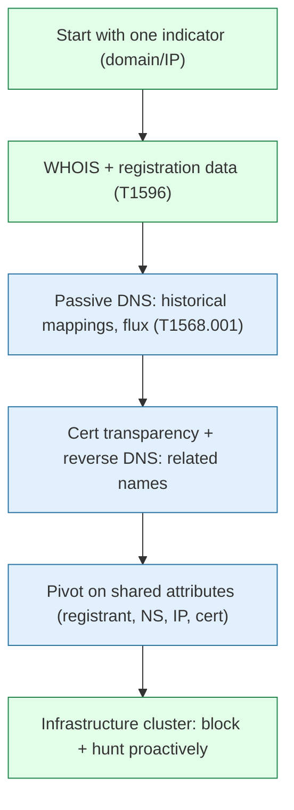

# Domain and IP Research for Malware Infrastructure (WHOIS, Passive DNS, Fast Flux)

## Summary

When defenders find one malicious domain or IP, research turns that single indicator into a map of the attacker's wider infrastructure — related domains, hosting, and patterns — so they can block and hunt proactively. The method uses open technical databases: WHOIS registration, passive DNS history, certificate transparency and hosting data (searching open technical databases, T1596). It is especially useful against resilient infrastructure like fast flux (T1568.001), where the whole network matters more than any one address. This is defensive and investigative research.

## Research sources and what they give

| Source | What you learn |
|---|---|
| **WHOIS** | Registrar, registration date, (often redacted) registrant, nameservers |
| **Passive DNS** | Historical domain-to-IP mappings over time, revealing flux and shared hosting |
| **Certificate transparency** | Certificates issued for a domain and related names (subdomains, siblings) |
| **Reverse DNS / IP intel** | Other domains on the same IP/ASN, hosting reputation |
| **Registration patterns** | Bulk registrations, naming schemes, shared nameservers linking campaigns |

Pivoting across these ("this IP hosted these domains, which share this registrant and this certificate") expands one indicator into an infrastructure cluster.

## Research flow

## Detection and hunting value

- **Expand blocking**: block the cluster, not just the one indicator the attacker expects you to find.
- **Spot flux**: short TTLs and many rotating IPs for one domain flag fast flux; the passive-DNS history shows the rotation.
- **Attribute campaigns**: shared registrants, nameservers or certificate patterns link separate incidents to one actor.
- **Pre-position**: newly registered domains matching an actor's naming scheme can be watched or pre-blocked.

## Defense

- **Operationalise the research**: feed discovered infrastructure into blocklists, DNS sinkholing and detection rules.
- **Automate pivoting** across WHOIS, passive DNS and certificate transparency to scale the analysis.
- **Verify before wide blocking**: shared hosting means an IP may carry benign domains too; confirm to avoid collateral damage.
- **Track over time**: infrastructure evolves, so re-run research and keep intelligence current.
- **Share indicators** (in appropriate formats) so the community blocks the cluster, not just you.

## ATT&CK mapping

| ID | Name | Tactic |
|---|---|---|
| T1596 | Search Open Technical Databases | Reconnaissance |
| T1568.001 | Dynamic Resolution: Fast Flux DNS | Command and Control |

## Explanation

Catching one malicious domain is catching one phone number; the attacker has dozens. Infrastructure research is working outward from that number through public directories — who registered it, what addresses it has used over time, what other numbers share the same back office — until you have the whole switchboard, not one line. Then you can disconnect the switchboard and recognise it when the actor reuses it. The caution is that some addresses are shared apartment blocks, so you confirm a line is theirs before cutting the whole building.
