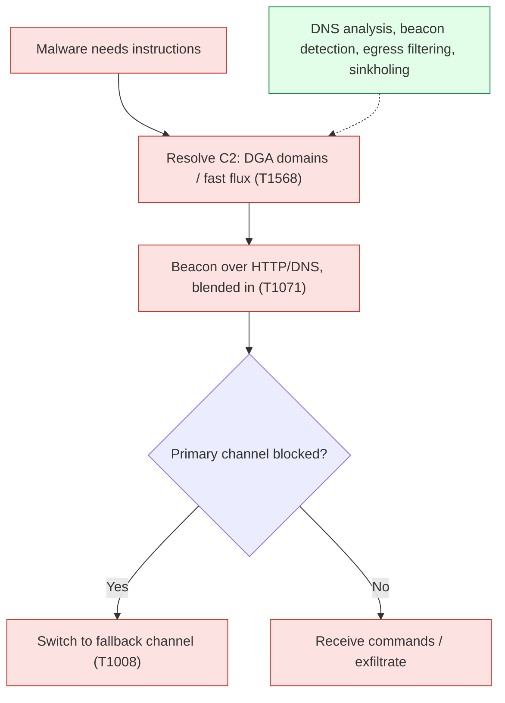

# Malware C2 Network Communication (Domain Flux, DGA, Protocols)

## Summary

Once malware is running, it usually needs to reach a command-and-control (C2) server for instructions, updates and to send data back. How it finds and talks to that server is a rich area for both attacker resilience and defender detection. Attackers hide C2 inside ordinary protocols (application-layer C2, T1071), make their infrastructure hard to block with generated domains (DGA, T1568.002) and rapidly changing addresses (fast flux, T1568.001), and keep fallback channels for when one is cut (T1008). Each resilience trick also creates a detectable fingerprint.

## How C2 stays reachable and hidden

| Technique | What it does | ATT&CK |
|---|---|---|
| **Protocol blending** | Carry C2 inside HTTP(S), DNS or other common protocols to look normal | T1071 |
| **Domain Generation Algorithms (DGA)** | Malware and server independently generate many candidate domains; attacker registers a few | T1568.002 |
| **Fast flux / domain flux** | Rapidly rotate the IPs (or domains) behind C2 so blocklists lag | T1568.001 |
| **Fallback channels** | Alternate C2 methods/addresses used if the primary is blocked | T1008 |
| **Beaconing** | Periodic check-ins (with jitter) to receive commands | — |

The attacker's goal is availability and stealth; the defender's advantage is that every one of these has a tell — beacon periodicity, high-entropy DGA names, unusual DNS volumes, or protocol misuse.

## C2 flow

## Detection

- **Beaconing**: regular connections to one destination with low timing variance (even with jitter, periodicity shows statistically).
- **DGA**: bursts of NXDOMAIN responses and lookups of high-entropy, algorithm-looking domain names.
- **Fast flux**: a single domain resolving to many IPs with very short TTLs across short windows.
- **Protocol misuse**: DNS with abnormal TXT/volume, HTTP with odd headers/URIs, C2 on non-standard ports.

## Defense

- **Analyse DNS**: flag high-entropy names, NXDOMAIN bursts and short-TTL flux; sinkhole known DGA/C2 domains.
- **Detect beaconing** with timing analysis over flow records, not just signatures.
- **Filter egress**: restrict outbound protocols/destinations so blended C2 has fewer paths out, and inspect DNS/HTTP.
- **Use threat intel** to block known C2 infrastructure, accepting that flux and DGA require behavioural detection too.
- **Correlate with endpoint** telemetry to tie suspicious traffic to a process.

## ATT&CK mapping

| ID | Name | Tactic |
|---|---|---|
| T1071 | Application Layer Protocol | Command and Control |
| T1568.002 | Dynamic Resolution: Domain Generation Algorithms | Command and Control |
| T1568.001 | Dynamic Resolution: Fast Flux DNS | Command and Control |
| T1008 | Fallback Channels | Command and Control |

## Explanation

Malware is a field agent who must phone headquarters without being traced or cut off. It hides the calls inside ordinary chatter (C2 in HTTP/DNS), and keeps headquarters reachable by agreeing a daily-changing list of phone numbers both sides can compute (DGA) and by swapping the physical lines constantly (fast flux), with a backup number if the main one is blocked (fallback). Each of these survival tricks is also a habit: too-regular calls, nonsense-looking numbers, lines that change every minute. Defenders catch the agent not by one wanted number but by spotting those habits.
