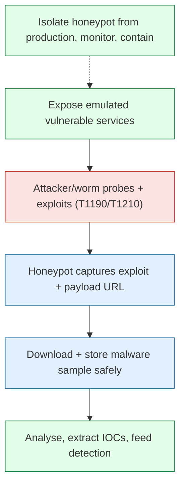

# Malware Collection with Honeypots (Nepenthes, Dionaea)

## Summary

A honeypot is a deliberately exposed, instrumented system whose only purpose is to be attacked, so defenders can observe attackers and collect their tools. **Low-interaction honeypots** such as the historical Nepenthes and its successor Dionaea emulate vulnerable network services to lure automated malware, capture the exploit attempt, and save the payload that would have been installed. Because any interaction with a honeypot is unexpected by definition, it produces high-signal, low-noise telemetry. It is a defensive collection technique, so no single ATT&CK technique maps to it; it captures attempts to exploit public-facing or remote services (T1190, T1210).

## How collection honeypots work

| Element | Role |
|---|---|
| **Service emulation** | Fake vulnerable services (SMB, HTTP, FTP, etc.) respond convincingly enough to progress an exploit |
| **Exploit capture** | The honeypot records the attack traffic and the stage it tries to deliver |
| **Payload download** | It fetches and stores the malware the exploit would have installed |
| **Containment** | The honeypot never actually runs the payload on a real system; it only collects it |
| **Interaction level** | Low-interaction emulates; high-interaction uses real (sandboxed) systems for deeper insight at higher risk |

The result is a feed of fresh, in-the-wild malware samples and attack indicators, gathered safely.

## Collection flow

## Detection and intelligence value

- **High-signal alerts**: any connection to a honeypot is suspect, so false positives are minimal.
- **Fresh samples**: captured payloads feed malware analysis and signature creation.
- **Attacker TTPs**: the exploit attempts reveal what is being targeted and how, informing patching priorities.
- **Early warning**: a spike of honeypot activity can flag a new worm or campaign before production is hit.

## Defense (safe deployment)

- **Isolate rigorously**: place honeypots where a compromise cannot reach production; firewall and monitor their outbound traffic so they cannot be used to attack others.
- **Prefer low-interaction for collection**: it captures samples with far less risk than running real systems.
- **Contain payloads**: store, never execute, captured malware on the honeypot; analyse it in a separate sandbox.
- **Watch legal/privacy scope**: only deploy on infrastructure you own and are authorised to run, and avoid entrapment concerns.
- **Operationalise output**: turn captured samples and IOCs into detections and blocking.

## ATT&CK mapping

No single ATT&CK technique; honeypots are a defensive collection tool that captures exploitation attempts (T1190, T1210) and the malware they deliver.

## Explanation

A honeypot is a decoy shop with an open till and hidden cameras, set up precisely so thieves will try it. Because no honest customer has any reason to walk in, everyone who does is worth recording — and the decoy quietly keeps the counterfeit tools they bring, without ever letting them touch the real vault. The payoff is a steady supply of the newest break-in kits and a clear view of who is trying what, all gathered without putting anything real at risk, provided the decoy shop is walled off so it cannot be turned against the neighbourhood.
