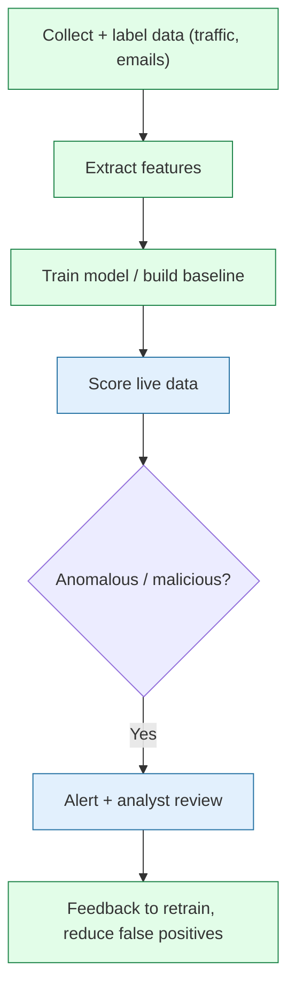

# AI for Spam, Phishing and Network Anomaly Detection

## Summary

Signature-based detection catches the known; machine learning aims to catch the unknown by learning what normal looks like and flagging deviations. Applied to security, ML classifies spam and phishing from message features and detects network anomalies from traffic that does not fit a learned baseline. It is a useful complement to signatures, not a replacement: it generalises to new variants but brings false positives, needs good data, and can itself be attacked. This is a defensive ML concept, so no single ATT&CK technique maps to it; it targets phishing (T1566) and C2/anomalous traffic (T1071).

## Where ML helps

| Problem | ML approach |
|---|---|
| **Spam filtering** | Supervised classifiers on message features (content, headers, sender reputation) |
| **Phishing detection** | Classify URLs/emails by lexical, domain-age, and content features (T1566) |
| **Network anomaly detection** | Unsupervised/semi-supervised models flag traffic deviating from a learned baseline |
| **Beaconing/C2 detection** | Models over flow timing/volume spotting periodicity a human would miss (T1071) |
| **Triage** | Rank alerts by likelihood to focus analyst attention |

Supervised methods excel when labelled examples exist (spam); anomaly detection suits cases where "bad" is rare or novel but "normal" can be characterised.

## Detection pipeline

## Detection

ML is the detection layer, with caveats to watch:

- **Baseline drift**: normal traffic changes, so stale models raise false positives; schedule retraining.
- **Evasion / adversarial input**: attackers can craft inputs to look benign (adversarial ML) or poison training data; validate data provenance.
- **Explainability**: prefer models whose alerts an analyst can understand and confirm.

## Defense

- **Use ML to augment, not replace, signatures and rules**; combine their strengths (precision of signatures, generalisation of ML).
- **Keep humans in the loop**: ML ranks and surfaces; analysts confirm, and their feedback retrains the model.
- **Protect the pipeline**: guard training data against poisoning, validate features, and monitor for model degradation.
- **Baseline carefully and retrain** as the environment evolves to control false positives.
- **Measure** precision/recall on held-out data so you deploy models that actually help.

## ATT&CK mapping

No single ATT&CK technique; this is defensive ML that helps detect phishing (T1566) and anomalous or C2 traffic (T1071).

## Explanation

Signatures are a most-wanted poster: great for faces you already have, useless for a new culprit. Machine learning is a seasoned guard who knows the normal rhythm of the building so well that anyone moving oddly draws a second look, even a stranger. The trade-off is that the guard sometimes stops an innocent visitor (false positives) and can be fooled by someone who studies their habits (adversarial attacks). So you keep the poster and the guard both, and you keep a human to make the final call.
