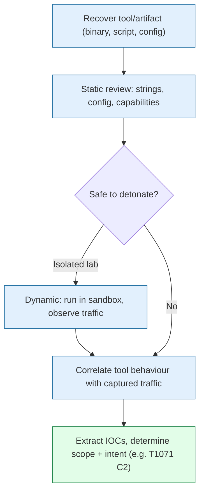

# Analyzing Network Traffic and Investigating Hacker Tools

## Summary

When an incident is underway, captured traffic and recovered attacker tools are the record of what happened. **Traffic analysis** reconstructs sessions from packets to answer who connected, what protocols were used, and what data moved. **Investigating hacker tools** means examining binaries, scripts and artifacts left behind to understand capability and intent. Together they turn raw evidence into a timeline and scope. This is a forensic analysis methodology, so no single ATT&CK technique maps to it; the analysis identifies techniques such as C2 (T1071) and exfiltration.

## Traffic analysis in practice

| Task | What it reveals |
|---|---|
| **Session reconstruction** | Follow a TCP stream to see the full exchange (commands, transfers) |
| **Protocol decode** | Identify and decode the application protocol in use, including tunnels |
| **Object extraction** | Carve transferred files from the capture for inspection |
| **Flow/timeline analysis** | Order events, find beaconing, measure volumes (exfiltration) |
| **Indicator extraction** | Pull domains, IPs, hashes, URIs for blocking and pivoting |

Encrypted traffic limits content analysis, but metadata (endpoints, timing, sizes, TLS fingerprints) still yields a great deal.

## Investigating recovered tools

Handle recovered tools as untrusted: examine them in an isolated lab, never on production, and treat extracted indicators as leads to confirm, not conclusions.

## Detection

Analysis supports detection and scoping. Signals it surfaces:

- C2 patterns (beaconing, odd protocols), data staging and exfiltration transfers.
- Attacker tool fingerprints (known frameworks, custom implants) in traffic and on disk.
- Lateral movement evidence: internal connections, credential reuse, remote-service access.

## Defense

- **Preserve evidence first**: capture and hash before analysing, maintain chain of custody.
- **Analyse in isolation**: a dedicated, network-isolated lab for detonating tools; assume they are hostile.
- **Correlate network and host**: match captured traffic to the recovered tool's behaviour to confirm findings.
- **Extract and operationalise IOCs**: feed domains, IPs and hashes into blocking and hunting, but verify before acting at scale.
- **Feed lessons back**: new signatures, detections and hardening from what the investigation revealed.

## ATT&CK mapping

No single ATT&CK technique; this is forensic analysis that identifies the techniques an intrusion used, especially C2 (T1071) and exfiltration (T1048).

## Explanation

After a break-in, two things tell the story: the building's recordings of who moved through it (captured traffic) and the tools the intruder dropped (recovered binaries). Traffic analysis replays the footage frame by frame to see exactly what was taken and how; examining the tools, carefully and in a sealed room, shows what the intruder was capable of. Put together, they give you the timeline, the scope, and the fingerprints to recognise the same crew next time — provided you kept the recordings and handled the dropped tools as if they were still dangerous.
