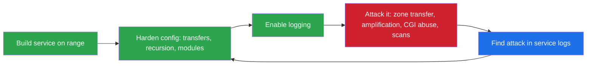

# Cyber Range Network Services Configuration (DNS, Mail, Web)

## Summary

A **cyber range** is a practice network that looks enough like a real one to make attacks and defences meaningful. *Cyber Operations* (O'Leary) builds one by standing up the services every organisation depends on (DNS, mail, web) on a mix of Linux and Windows hosts, then attacking and defending them. The value is twofold: you learn how each service is configured securely, and you learn what each attack looks like **in that service's own logs**. This page covers the service-hardening lessons for DNS (BIND) and web (Apache).

## DNS with BIND

A range typically has a primary (master) and secondary (slave) nameserver, queried with `dig` and `nslookup` and managed with `rndc`. The security-relevant `named.conf` statements, as documented in the BIND 9 reference:

| Statement | What it controls | Secure practice |
|---|---|---|
| `allow-transfer` | Which hosts may receive zone transfers | Limit to your secondary servers; an open transfer hands attackers your whole zone (T1590.002 DNS reconnaissance) |
| `recursion` / `allow-recursion` | Whether the server resolves names on behalf of clients, and for whom | Disable recursion on authoritative servers; allow it only for internal clients on resolvers |
| `rate-limit` | Response rate limiting for UDP responses | Enable to stop the server being used to amplify reflection DoS attacks (T1498.002) |
| `version` | The answer to a `version.bind` CHAOS TXT query | Set `version none` to disable these queries, so you don't advertise the exact version |
| `querylog` | Logging of queries | Enable on the range so attacks leave evidence |
| `forwarders` | Upstream resolvers to forward queries to | Point at resolvers you trust |

**Amplification**: an open resolver answering spoofed queries sends large responses to a victim who never asked. Turning off open recursion and enabling response rate limiting are the standard defences.

## Web with Apache

| Area | Lesson |
|---|---|
| **Modules** | Enable only what you need. Modules such as status pages, per-user directories, aliases and CGI each add attack surface. `mod_status` provides information on server activity and performance, so restrict who can view it |
| **TLS** | Configure `mod_ssl` with current protocol versions and certificates |
| **Logging** | Keep access logs; the Common Log Format records client host, user, time, request line, status and bytes, enough to reconstruct most web attacks |
| **WAF** | Add **ModSecurity** (now maintained under OWASP; it began as an Apache module) to filter malicious requests in front of applications (helps against T1190) |

## Mail

The book configures mail as another range service. The same principles apply: no open relaying, authenticated submission, TLS, and logs kept and reviewed.

## ATT&CK mapping

- **T1498.002 Reflection Amplification**: DNS amplification via open resolvers.
- **T1590.002 DNS**: zone transfers used for reconnaissance.
- **T1190 Exploit Public-Facing Application**: attacks on web services the WAF helps block.

## Explanation

A cyber range is a fire-training building. You fit it with the same wiring and appliances as a real office, set fires on purpose, and learn both how to put them out and what the smoke detectors recorded while they burned.
