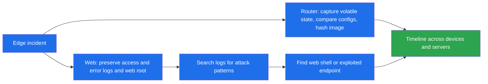

# Investigating Routers and Web Attacks

## Summary

Two kinds of systems sit on the edge of most networks and get attacked first: **network devices** (routers, firewalls, VPN gateways) and **web servers**. Neither fits the usual workstation forensics playbook. Network devices keep most of their useful state in volatile memory and run a monolithic vendor OS you can't easily image. Web servers record attacks in access logs that are huge and mostly benign. This page covers what to collect and what to look for on each. The source chapters date from 2003; the device examples have changed, the method has not.

## Routers and other network devices

### What to collect, most volatile first

| Evidence | Why |
|---|---|
| Current running configuration | May differ from the saved configuration if an attacker changed it live |
| Saved (startup) configuration | Compare with the running one |
| Routing, ARP and connection tables | Show unexpected routes, tunnels or peers |
| Device logs (and anything sent to syslog) | Logins, configuration changes, interface events |
| OS image identity (version, hash) | Detect a modified system image |

Collect through the console or an out-of-band session where possible, record every command you run, and **don't reboot** the device first: a reboot wipes volatile state.

### What attackers do to devices

- **Modify the system image** (T1601.001 Patch System Image). ATT&CK notes that many network devices are monolithic, so replacing or patching one OS file changes everything. Compare the image hash against the vendor's published value.
- **Implant a backdoor password** in the OS image to bypass normal authentication (T1556.004 Network Device Authentication).
- Change configuration: new accounts, ACLs, routes, or traffic mirroring.
- Exploit the device's own management or VPN interfaces (T1190).

## Web attacks

### Where the evidence is

- **Access logs**: Apache's Common Log Format records client host, identity, user, time, request line, status and bytes; IIS writes logs by default under `%SystemDrive%\inetpub\logs\LogFiles`.
- **Error logs**: failed requests and application errors, often triggered by attack payloads.
- **The web root**: unexpected new or changed scripts.

### What to look for in logs

| Pattern | Possible attack |
|---|---|
| SQL keywords, quotes and comment markers in parameters | SQL injection (T1190) |
| `../` sequences in paths | Directory traversal |
| Script tags in parameters | Cross-site scripting |
| Bursts of 404s across many paths from one client | Scanning or content discovery |
| Requests to a script nobody else uses, from few IPs, with POST bodies | **Web shell** (T1505.003) |

A web shell is a script placed on the server that gives the attacker a command interface through the website. Find it by diffing the web root against a known-good deployment and by looking for rarely requested scripts.

## Practical rules

- Forward device and web logs to a central log store before an incident; local logs on a compromised device can't be trusted.
- Keep known-good copies of device configurations and web content to diff against.
- Synchronise time (NTP) across devices so timelines line up.

## ATT&CK mapping

- **T1601.001 Patch System Image**, **T1556.004 Network Device Authentication**: device compromise.
- **T1190 Exploit Public-Facing Application**, **T1505.003 Web Shell**: web compromise.

## Explanation

Routers are the building's doors and corridors; web servers are the reception desk. When investigating, you check whether the doors' locks were swapped (the device image) and whether anyone rerouted the corridors (configuration and routes). At reception, you read the visitor book (access logs) for anyone who signed in with a strange name or kept asking for rooms that don't exist.
