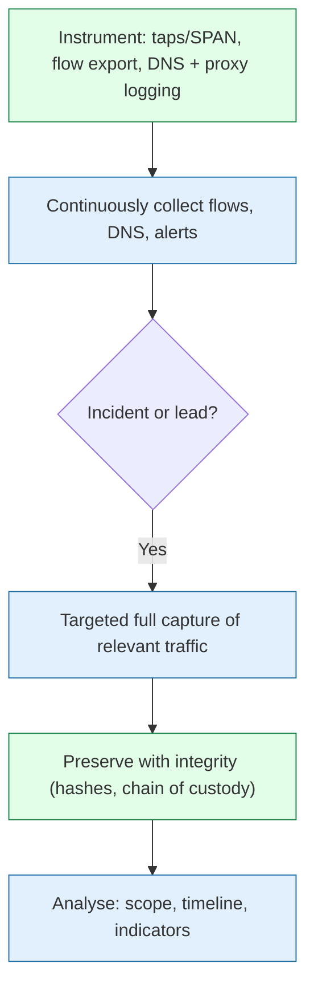

# Network-Based Evidence Collection and Monitoring

## Summary

Network evidence tells you what actually crossed the wire — who talked to whom, when, and sometimes what was said — independently of a possibly-compromised endpoint. Collecting it well, before and during an incident, is what makes detection and investigation possible. The discipline spans continuous monitoring (so you have records when something happens) and targeted collection (capturing specific traffic during a live incident). Done soundly, it preserves evidence that holds up later. It is a forensics and monitoring methodology, so no single ATT&CK technique maps to it.

## Types of network evidence

| Source | What it provides |
|---|---|
| **Full packet capture (PCAP)** | Complete content of traffic; richest but storage-heavy |
| **Flow records (NetFlow/IPFIX)** | Who-talked-to-whom, ports, bytes, timing; compact, great for scale |
| **DNS logs** | Name lookups revealing C2 domains, DGA, exfiltration over DNS |
| **Proxy/firewall logs** | Allowed/denied connections, URLs, destinations |
| **IDS/IPS alerts** | Signature and anomaly hits with context |
| **TLS metadata (JA3/SNI)** | Fingerprints and destinations even without decryption |

Layering these gives both breadth (flows/DNS everywhere, cheaply) and depth (full capture where it matters).

## Collection workflow

## Detection

Monitoring is itself the detection layer. High-value signals:

- Beaconing (regular, low-variance connections to one destination) in flow records.
- DNS anomalies: high-entropy domains (DGA), large TXT volumes (DNS tunnelling), lookups to known-bad domains.
- Connections to unusual destinations, ports, or at unusual times; large outbound transfers (exfiltration).
- IDS/IPS signature hits correlated across sources.

## Defense

- **Instrument before you need it**: deploy taps/SPAN, flow export and DNS/proxy logging across key segments so records exist when an incident starts.
- **Retain the right balance**: flows and DNS broadly and for longer; full packet capture at chokepoints and for incidents.
- **Preserve integrity**: hash captures, record time sources, and maintain chain of custody so evidence is admissible.
- **Centralise and correlate** in a SIEM, and baseline normal traffic so anomalies stand out.
- **Protect the monitoring itself** (access control, integrity) since attackers target logs.

## ATT&CK mapping

No single ATT&CK technique; this is defensive forensics and monitoring that detects and reconstructs many techniques (for example C2 over T1071, exfiltration over T1048).

## Explanation

Endpoints can be tampered with; the wire is a more honest witness. Network monitoring is keeping good CCTV and a visitor log for the whole building: most of the time you record cheaply who came and went (flows and DNS), and when something looks wrong you roll targeted high-resolution cameras (full capture) on the right corridor. The work that pays off is installing the cameras before the break-in, because you cannot capture traffic that has already passed.
