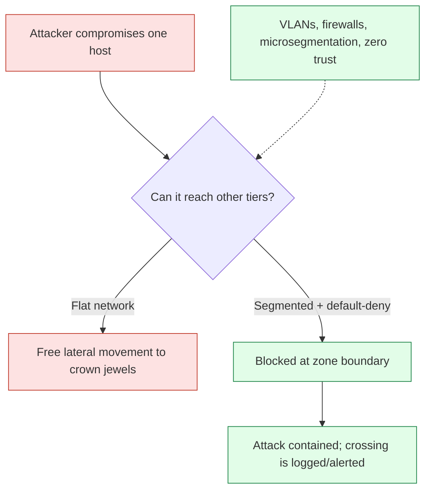

# Network Segmentation

## Summary

Network segmentation divides a network into separate zones with controlled paths between them, so a compromise in one zone does not grant free movement across the whole estate. It is one of the highest-value defensive controls because it directly limits **lateral movement** and shrinks blast radius: a foothold on a user laptop should not reach the database tier unchallenged. It is a defensive architecture concept, so no single ATT&CK technique maps to it; rather, it blunts many (lateral movement, discovery, exploitation of remote services).

## Ways to segment

| Approach | Mechanism |
|---|---|
| **VLANs + ACLs** | Separate broadcast domains with access control between them |
| **Firewalls / zones** | Enforce allowed flows between tiers (DMZ, internal, management, OT) |
| **Microsegmentation** | Per-workload policy (host firewalls, SDN) so even same-subnet hosts are gated |
| **Zero-trust access** | Authenticate and authorise each connection rather than trusting a network location |
| **Air gap / strong isolation** | Physically or logically separate the most sensitive systems |

The guiding idea is **least privilege for traffic**: define which zones may talk to which, on which ports, and deny the rest by default.

## How it limits an attack

## Detection

- Denied cross-zone connection attempts spiking from one host (a sign of a contained attacker probing boundaries).
- East-west traffic that violates the intended flow matrix (database tier initiating outbound, user VLAN talking to management).
- New or unexpected routes/bridges between segments (possible boundary bridging).

## Defense

- **Design around data sensitivity**: group assets by trust/criticality and define allowed flows between zones, default-deny.
- **Separate management, user, server and OT/IoT** networks; keep crown-jewel systems in tightly controlled zones.
- **Use microsegmentation or zero-trust** so proximity on the same subnet is not implicit trust.
- **Log and alert on cross-zone denials and anomalies**, and review the flow matrix as the environment changes.
- **Test the segmentation**: verify that paths you believe are blocked actually are.

## ATT&CK mapping

No single ATT&CK technique; segmentation is a defensive control that limits lateral movement (T1021, T1210) and discovery across the environment.

## Explanation

A flat network is an open-plan building: break one window and you can stroll into every room. Segmentation adds internal walls and locked doors so the person who climbs through the lobby window still cannot reach the vault without passing more guards, each of whom can raise an alarm. It does not stop the first break-in, but it decides whether that break-in is a contained incident or a full compromise — which is usually the difference that matters most.
