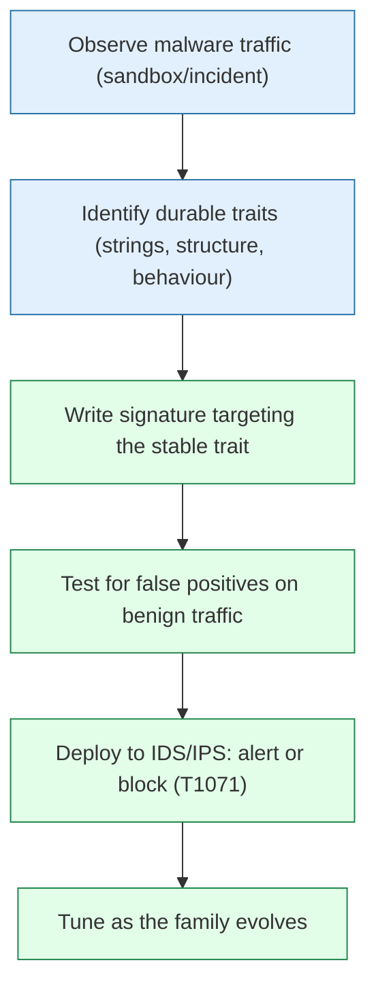

# Network Signatures for Malware Detection

## Summary

Malware has to communicate — to reach its command-and-control server, download stages, or exfiltrate data — and that communication leaves recognisable patterns. A **network signature** is a rule that matches such a pattern so an IDS/IPS (Snort, Suricata) can alert or block. Good signatures target durable traits of a malware family's traffic rather than a single sample's bytes, so they survive recompilation. This is a detection-engineering concept, so no single ATT&CK technique maps to it; the signatures detect techniques such as application-layer C2 (T1071).

## What signatures key on

| Signature target | Example |
|---|---|
| **Content strings** | A distinctive User-Agent, URI path, header order, or byte sequence in the payload |
| **Protocol structure** | A malformed or non-standard use of HTTP/DNS/TLS characteristic of the family |
| **Destinations** | Known-bad domains/IPs, DGA-style hostnames, suspicious TLDs |
| **Behaviour** | Beaconing interval and jitter, fixed payload sizes, periodic check-ins |
| **TLS fingerprints** | JA3/JA3S client/server hashes, odd certificate attributes |

The strongest signatures combine a stable protocol/behaviour trait with context, so they catch the family without flooding analysts with false positives on benign look-alikes.

## From traffic to rule

## Detection

The signatures are the detection. Deployment considerations:

- Place sensors where malware traffic must pass (egress, internal chokepoints) including on encrypted-traffic metadata (SNI, JA3) where payloads are opaque.
- Correlate signature hits with endpoint telemetry to confirm, not just alert.
- Watch for evasion: domain rotation (DGA/fast flux), encryption, and timing jitter that defeats naive interval rules.

## Defense

- **Write resilient signatures** on stable traits (protocol misuse, behaviour, infrastructure) rather than one sample's exact bytes.
- **Test against benign traffic** to keep false positives low; a noisy rule gets ignored.
- **Layer signatures with anomaly detection and threat intel** (IOCs, known-bad infrastructure) so evasion of one layer is caught by another.
- **Keep rules current** via feeds and retune as families change tooling.
- **Combine network with endpoint detection**; neither alone is complete.

## ATT&CK mapping

No single ATT&CK technique; these signatures detect malware communication techniques, especially application-layer C2 (T1071) and dynamic resolution (T1568).

## Explanation

Malware is a spy who must phone home, and phoning home has a tell: the same odd greeting, the same call every ten minutes, the same shady number. A network signature is a wiretap rule that recognises that tell and raises a flag. The craft is to key on habits the spy cannot easily change — how they structure the call, how regularly they check in — rather than the exact words of one conversation, which they will simply rephrase next time.
