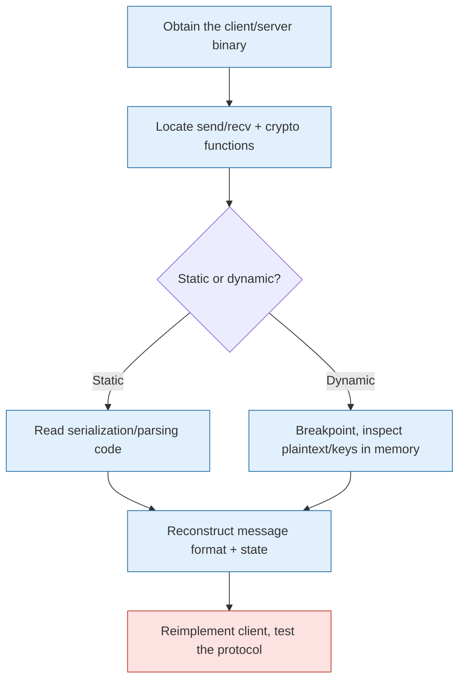

# Application Reverse Engineering for Protocols

## Summary

Traffic capture alone cannot always explain a protocol: encryption, compression or custom encoding may hide the structure, and you only see the messages, not the logic that builds them. **Application reverse engineering** recovers that logic by analysing the program that speaks the protocol — statically (reading disassembled or decompiled code) or dynamically (observing it run). It reveals how messages are constructed, how keys are derived, and what each field means, so you can reimplement the protocol faithfully. It is a methodology, not an attack, so no ATT&CK technique maps to it directly.

## Static versus dynamic

| Approach | What it involves | Strength |
|---|---|---|
| **Static analysis** | Disassemble/decompile the binary, read the code that serializes messages | Complete view; no need to trigger every path |
| **Dynamic analysis** | Run under a debugger, set breakpoints on send/recv and crypto calls, inspect memory | See real values (keys, plaintext) at the moment of use |
| **Hybrid** | Use static analysis to find the interesting functions, dynamic to watch them run | Fastest route to understanding in practice |

Key targets are the functions just before data is sent (where plaintext is serialized) and just after it is received (where it is parsed), and the crypto routines that wrap them — breakpoints there expose structure that the wire alone hides.

## Workflow

## Detection

Reverse engineering happens off the target, so it is largely invisible on the network. What may be observed:

- A newly built, non-standard client that reproduces the protocol appearing in traffic (unusual implementation quirks, timing).
- Debugging or tampering on endpoints you control (anti-tamper or integrity checks firing).
- Captured sessions being replayed or probed after a quiet period (the result of a reimplemented client).

## Defense

- **Do not rely on obscurity**: a proprietary or obfuscated protocol can be reverse engineered. Put security in authentication, encryption and server-side validation, not in secret formats.
- **Authenticate endpoints and messages** so a reimplemented client cannot simply join, even once it understands the format.
- **Use standard, reviewed cryptography**; home-grown schemes fall quickly once the code is read.
- **Apply anti-tamper and integrity checks** as speed bumps, understanding they slow but do not stop a determined analyst.

## ATT&CK mapping

No single ATT&CK technique; this is reverse-engineering methodology that enables understanding and testing of a protocol. Resulting activity maps to the technique the rebuilt client exercises.

## Explanation

If you cannot understand a conversation by listening — because it is in code — you can instead study the person's phrasebook and watch them write a message. Reading the program is reading the phrasebook; debugging it is looking over their shoulder as they encode a sentence and seeing the plain words before they are scrambled. Either way you learn the language well enough to speak it. The defence is not a secret phrasebook, which can always be studied, but demanding proof of identity for every sentence spoken.
