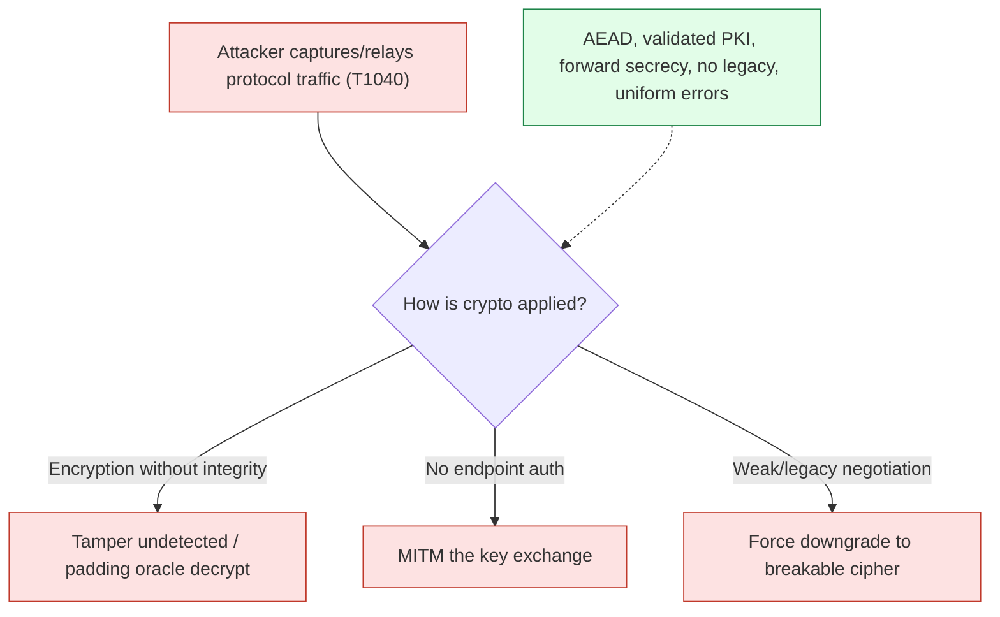

# Cryptography in Network Protocols (Ciphers, Padding Oracle, PKI, TLS)

## Summary

Network protocols use cryptography to provide confidentiality, integrity and authentication, but the guarantees hold only if the crypto is used correctly. Many real-world breaks are not of the cipher itself but of how a protocol applies it: a mode without integrity, an oracle that leaks a bit per guess, or a certificate nobody validates. When any of these fails, a network attacker can read or tamper with traffic they have captured (network sniffing, T1040). Understanding the pieces — ciphers, integrity, PKI — is how you tell a sound protocol from a fragile one.

## The pieces and how they fail

| Piece | Purpose | Common failure |
|---|---|---|
| **Symmetric ciphers / modes** | Encrypt bulk data | Using encryption without integrity (e.g. CBC without a MAC), weak/legacy ciphers |
| **Padding** | Fit data to block size | Padding oracle: the server reveals whether padding was valid, enabling decryption |
| **MAC / AEAD** | Detect tampering | Missing integrity, or MAC-then-encrypt mistakes; prefer AEAD (AES-GCM, ChaCha20-Poly1305) |
| **Key exchange** | Agree a shared key | No forward secrecy, weak parameters, or unauthenticated exchange (MITM) |
| **PKI / certificates** | Authenticate the endpoint | Not validating the certificate chain, name, or expiry; trusting any cert |
| **Protocol version** | Negotiate the channel | Downgrade to a weak version/cipher an attacker forces |

A **padding oracle** is the classic lesson: the cipher is fine, but a server that distinguishes "bad padding" from "bad MAC" leaks enough to decrypt ciphertext one byte at a time. The fix is authenticated encryption and uniform error handling.

## Where protocol crypto breaks

## Detection

- Negotiation of obsolete protocol versions or weak ciphers in server logs or TLS scans.
- Repeated, systematic requests that differ by one byte and depend on error responses (padding-oracle probing).
- Certificate warnings, unexpected issuers, or clients that accept invalid certificates.
- Downgrade patterns: sessions settling on the weakest mutually supported option unusually often.

## Defense

- **Use authenticated encryption (AEAD)**; never encrypt without integrity, and avoid hand-rolled MAC-then-encrypt.
- **Return uniform errors** so decryption/padding/MAC failures are indistinguishable (defeats padding oracles).
- **Validate certificates fully**: chain, hostname, expiry, and revocation; reject on failure.
- **Require modern versions with forward secrecy** (TLS 1.2+/1.3, ECDHE) and disable legacy ciphers/versions to prevent downgrade.
- **Use standard, reviewed libraries** rather than custom cryptographic code.

## ATT&CK mapping

| ID | Name | Tactic |
|---|---|---|
| T1040 | Network Sniffing | Credential Access, Discovery |

## Explanation

Good cryptography in a protocol is like a sealed, tamper-evident, signed courier pouch: you cannot read it, cannot alter it unnoticed, and can prove who sent it. Most failures are not a broken seal but a careless process around it — a pouch that is locked but not tamper-evident (no integrity), a clerk who tells you "wrong wrapping" versus "wrong signature" and thereby helps you guess the contents (padding oracle), or a guard who accepts any signature at all (no certificate validation). The fix is a pouch that is sealed, signed, verified every time, and gives nothing away when you get it wrong.
