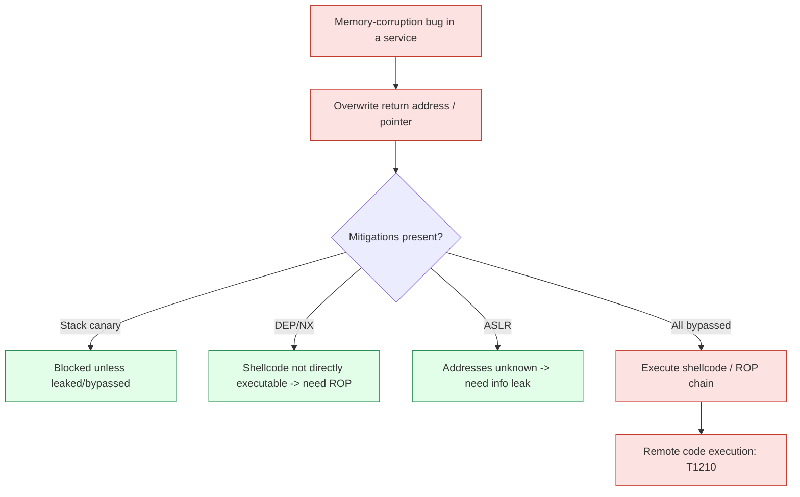

# Exploiting Memory Corruption and Writing Shellcode

## Summary

When a network service mishandles input and corrupts its own memory, an attacker who controls that input may be able to redirect the program's execution to code of their choosing. This is the classic path from a memory-safety bug to remote code execution (exploitation of remote services, T1210; or client-side execution when the vulnerable code is a client, T1203). **Shellcode** is the small, position-independent payload the exploit ultimately runs. Modern systems add mitigations that make this far harder, so real exploitation is as much about defeating defences as about the original bug. This file is a conceptual overview for defenders and authorised testers, not a how-to.

## The building blocks

| Concept | Role |
|---|---|
| **Control-flow hijack** | Overwrite a saved return address or function pointer to redirect execution |
| **Shellcode** | Compact machine code the attacker wants to run (spawn a shell, stage a payload) |
| **ROP (Return-Oriented Programming)** | Chain existing code fragments ("gadgets") to act despite non-executable memory |
| **Information leak** | A separate bug that reveals memory addresses, needed to defeat ASLR |
| **Mitigation bypass** | Techniques to work around canaries, DEP/NX, ASLR, CFG and similar defences |

A real exploit usually needs a chain: a leak to learn where things are, then a control-flow hijack, then ROP to pivot into attacker code or disable protections.

## Why mitigations matter

## Detection

- Service crashes with corrupted stack/heap, or faults in unusual memory regions (failed or partial exploit attempts).
- The vulnerable service spawning unexpected child processes (a shell, an interpreter) — a strong sign of achieved execution.
- Exploit-mitigation events: stack-smashing detection, DEP/NX violations, CFG failures.
- Network input immediately preceding a crash matching known exploit structure.

## Defense

- **Keep all exploit mitigations on**: stack canaries, DEP/NX, ASLR/PIE, FORTIFY_SOURCE, RELRO, and control-flow integrity where available.
- **Fix the underlying memory-safety bugs**; mitigations raise the cost but a bug plus a leak still chains.
- **Prefer memory-safe languages** for network-facing parsers and services.
- **Sandbox and least-privilege** services so that even successful execution is contained (seccomp, reduced privileges, isolation).
- **Patch promptly** and monitor for the crash and child-process indicators above.

## ATT&CK mapping

| ID | Name | Tactic |
|---|---|---|
| T1210 | Exploitation of Remote Services | Lateral Movement |
| T1203 | Exploitation for Client Execution | Execution |

## Explanation

A memory-corruption exploit is convincing a machine that an attacker's instructions are its own next step. The original bug cracks the door; modern mitigations are a series of extra locks — a tripwire on the frame (canary), a rule that the intruder's own tools will not fire inside (DEP/NX), and the building's rooms shuffled each day so the intruder does not know where anything is (ASLR). Serious exploitation is picking each lock in turn, often needing a separate peek at the floor plan (an info leak). Defenders keep every lock engaged, fix the cracked door, and make sure that even a break-in reaches only one sealed room.
