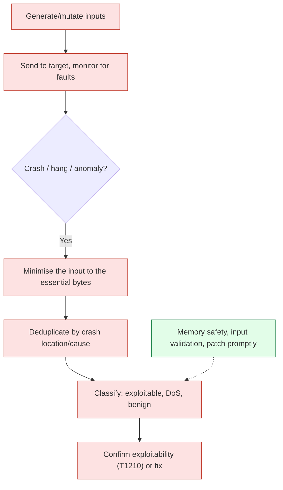

# Fuzzing and Vulnerability Triage

## Summary

Fuzzing is automated bug-finding: feed a program large volumes of malformed or mutated input and watch for crashes, hangs or abnormal behaviour that reveal where it mishandles data. For network protocols it drives the many parsing and state bugs out into the open. **Triage** is the second half — turning a pile of crashes into a small set of distinct, understood, exploitable bugs. A remotely triggerable, exploitable crash in a network service is a path to exploitation (T1210). Fuzzing is used by attackers and defenders alike; the difference is who fixes what it finds.

## Fuzzing approaches

| Approach | How inputs are generated |
|---|---|
| **Mutation-based** | Take valid samples and randomly mutate them (flip bytes, resize fields) |
| **Generation-based** | Build inputs from a model/grammar of the protocol, exercising structure deliberately |
| **Coverage-guided** | Instrument the target and favour inputs that reach new code paths (e.g. AFL-style) |
| **Stateful** | Drive the protocol through its state machine so deeper states are reached |

Coverage guidance and a protocol model dramatically improve depth: random bytes rarely pass a length or checksum field, while a model-aware fuzzer gets past the front door to the fragile interior.

## From crash to triaged bug

## Triage essentials

- **Minimise**: reduce a crashing input to the smallest bytes that still trigger the fault.
- **Deduplicate**: many crashes share one root cause; group by crash site and call stack.
- **Classify severity**: distinguish a controllable memory write (likely code execution) from a null-dereference (usually just denial of service).
- **Reproduce reliably** and capture the conditions, so the bug can be fixed or demonstrated.

## Detection

- Service crash/restart storms, memory-protection faults, or hangs during a flood of malformed input.
- High volumes of structurally invalid messages to one service (a fuzzing campaign seen from outside).
- Crash-dump patterns clustering around specific parsing functions.

## Defense

- **Fuzz your own software** continuously, especially parsers and protocol handlers, and fix what surfaces.
- **Build on memory-safe languages and validated input handling** so many fuzzing crashes cannot occur.
- **Run under sanitizers** (ASan, UBSan) in testing to catch subtle corruption a plain crash would miss.
- **Patch promptly**: a crash you found by fuzzing is one an attacker can find too.
- **Add resource limits and watchdogs** so a hang does not become an outage.

## ATT&CK mapping

| ID | Name | Tactic |
|---|---|---|
| T1210 | Exploitation of Remote Services | Lateral Movement |

## Explanation

Fuzzing is shaking a machine with thousands of wrong inputs to see what rattles loose, then triage is picking through the fallen parts to tell a cracked gear (exploitable) from a bit of harmless dust (a benign crash). It is how both attackers and defenders find the same bugs; the only question is who gets there first and whether they fix it or weaponise it. Defenders win this race by shaking their own machines early and often, with sanitizers on to catch the quiet cracks.
