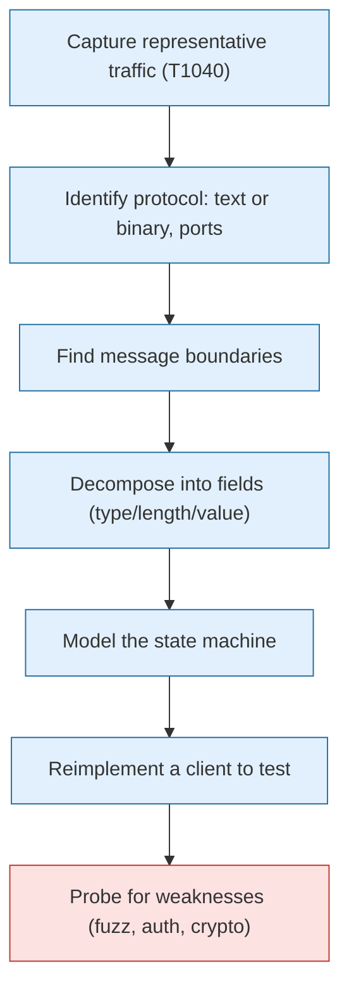

# Network Protocol Analysis Methodology

## Summary

To find flaws in how two systems talk, you first have to understand the conversation. Network protocol analysis is the structured process of capturing traffic, identifying the protocol, and reconstructing its structure and state machine so it can be tested or reimplemented. It applies equally to a documented protocol you want to verify and an undocumented, proprietary one you must reverse. Capturing the traffic is the entry point (network sniffing, T1040); the methodology is what turns raw packets into understanding.

## The method

| Stage | Goal |
|---|---|
| **Capture** | Record representative traffic (passively on the wire, or via a proxy/MITM for encrypted or app traffic) — T1040 |
| **Identify** | Determine the protocol, ports, and whether it is text or binary |
| **Delimit** | Find message boundaries: length prefixes, delimiters, or fixed sizes |
| **Parse fields** | Break each message into fields (type, length, value) and infer their meaning |
| **Model state** | Work out the sequence: handshake, authentication, data, teardown |
| **Reimplement** | Build a client/parser to interact with the protocol for testing |

Good captures matter: you need varied, representative traffic (different actions, sizes, error cases) to see the whole protocol, not one path through it.

## Flow

## Detection

Protocol analysis is usually done by the tester, but on a defended network the capture step is observable:

- Interfaces in promiscuous mode, or unexpected port mirroring/tap activity.
- A new proxy or MITM inserted into application traffic (certificate changes, altered routes).
- Unusual clients replaying or probing a protocol with malformed or boundary-case messages.

## Defense

- **Encrypt protocols** so captured traffic reveals little, and authenticate endpoints to resist MITM capture.
- **Document and review your own protocols**: a protocol you understand fully is one you can secure; analyse it yourself before an attacker does.
- **Validate message structure strictly** on both ends, so a reimplemented or malformed client is rejected rather than mishandled.
- **Monitor** for capture infrastructure (taps, promiscuous interfaces, rogue proxies) on sensitive segments.

## ATT&CK mapping

| ID | Name | Tactic |
|---|---|---|
| T1040 | Network Sniffing | Credential Access, Discovery |

## Explanation

Understanding a protocol is like transcribing a conversation in an unfamiliar language: first you record enough of it, then you spot where one sentence ends and the next begins, work out which words are names, numbers and commands, and finally learn the back-and-forth rules well enough to hold your own conversation. Only then can you probe whether the other speaker mishears certain phrases. Defenders win by speaking in cipher, writing down their own language precisely, and refusing malformed sentences.
