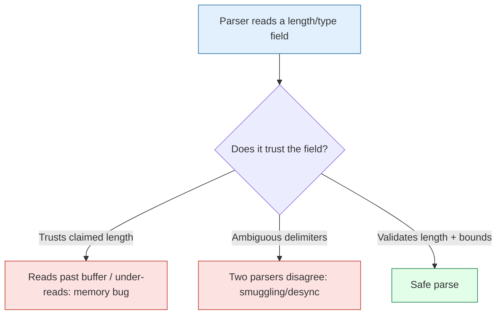

# Network Protocol Structures (Binary and Text)

## Summary

Every network protocol is an agreement on how to turn structured data into a byte stream and back. Understanding the common building blocks — how fields are sized, delimited, and ordered — lets a tester parse unknown traffic and spot where a parser can be tricked. Protocols split broadly into **binary** (compact, fixed layouts) and **text** (human-readable, delimited). Most parsing vulnerabilities trace back to a mismatch between what a field claims and what the data actually contains. This is foundational knowledge, so no single ATT&CK technique maps to it.

## Common structural elements

| Element | Description |
|---|---|
| **Fixed-length fields** | A field of known size at a known offset (a 4-byte integer) |
| **Length-prefixed fields** | A length value followed by that many bytes (the classic TLV: type-length-value) |
| **Delimited fields** | Fields separated by a marker (`\r\n` lines, commas), common in text protocols |
| **Endianness** | Byte order of multi-byte integers (big-endian "network order" vs little-endian) |
| **Alignment/padding** | Bytes inserted so fields fall on convenient boundaries |
| **Checksums/lengths** | Integrity and size fields that parsers must validate, not trust |

**Binary protocols** (TCP/IP headers, DNS, TLS records) pack data tightly with fixed and length-prefixed fields. **Text protocols** (HTTP, SMTP, FTP) use readable tokens and delimiters, which are easy to read but prone to ambiguity (how long is a line, which delimiter wins).

## Where structure becomes a weakness

## Detection

- Messages whose declared length does not match their actual size, or impossible field combinations, reaching an IDS or parser log.
- Protocol anomalies: text protocols with unusual delimiters or oversized lines; binary protocols with out-of-range type/length values.
- Two components in a chain (proxy and server) logging different interpretations of the same message (a sign of parser disagreement).

## Defense

- **Validate every length and type field** against the actual data and against sane bounds before using it.
- **Prefer well-specified formats** and mature, maintained parsers over hand-rolled ones.
- **Make parsing unambiguous**: one delimiter rule, one length semantics, applied identically everywhere in the path to prevent desync and smuggling.
- **Fuzz parsers** with malformed structures (see [Fuzzing and Vulnerability Triage](fuzzing-and-vulnerability-triage.md)) and fix the crashes.

## ATT&CK mapping

No single ATT&CK technique; this is foundational protocol knowledge underlying parsing vulnerabilities and their exploitation (for example T1210).

## Explanation

A protocol message is a parcel packed to an agreed scheme: some boxes are a fixed size, some are labelled "the next N items belong together," and some are just things separated by dividers. Trouble starts when the label says "ten items follow" but only three are in the box, and the unpacker keeps grabbing into the next parcel. The safe unpacker counts what is actually there before trusting any label, and everyone in the delivery chain agrees on exactly how parcels are packed.
