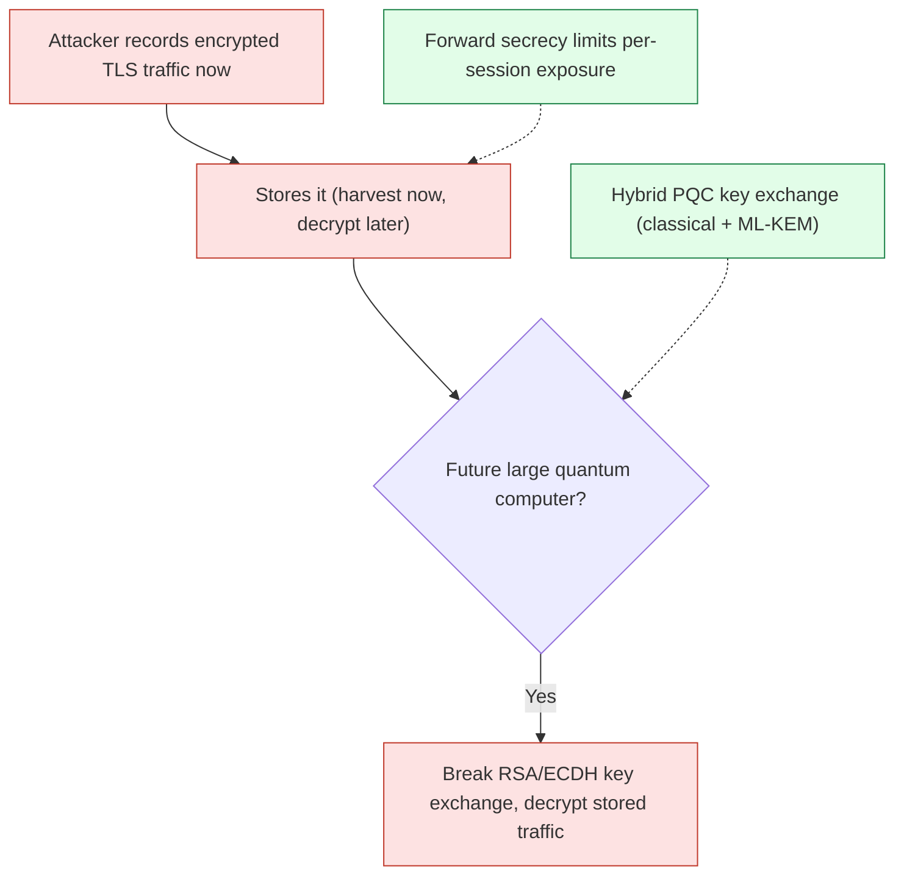

# TLS Protocol and Post-Quantum Cryptography

## Summary

TLS (Transport Layer Security) is the protocol that secures most internet traffic. Its current version, **TLS 1.3**, streamlines the handshake, removes legacy weak options, and requires forward secrecy by default. **Post-quantum cryptography (PQC)** addresses a longer-horizon threat: a sufficiently powerful quantum computer would break the public-key algorithms (RSA, classic Diffie-Hellman, ECDH) that TLS uses to exchange keys and authenticate. The response is new, quantum-resistant algorithms and hybrid handshakes. This is a protocol and cryptography concept, so no ATT&CK technique maps to it.

## How TLS 1.3 secures a connection

| Step | What happens |
|---|---|
| **Key exchange** | Ephemeral (EC)DHE establishes a shared secret with forward secrecy |
| **Authentication** | The server (and optionally client) proves identity with a certificate |
| **Cipher** | Only strong AEAD suites (AES-GCM, ChaCha20-Poly1305) are allowed |
| **Handshake integrity** | The handshake is authenticated, resisting tampering and downgrade |
| **Fewer round trips** | TLS 1.3 completes in one round trip (with an optional 0-RTT mode that has replay caveats) |

TLS 1.3 deliberately dropped the weak primitives (RSA key transport, CBC-mode suites, RC4, static DH) whose misuse caused earlier attacks.

## The quantum threat and the PQC response

The pressing risk is **harvest-now-decrypt-later**: an adversary records today's traffic and decrypts it once quantum computers mature. Because the key exchange is the quantum-vulnerable part, migrating it first protects confidentiality retroactively. NIST has standardised post-quantum algorithms (notably ML-KEM for key encapsulation and ML-DSA/SLH-DSA for signatures), and deployments are rolling out **hybrid** key exchanges that combine a classical algorithm with a PQC one, so the connection is safe unless both are broken.

## Detection

- Negotiation of pre-1.3 TLS versions or legacy cipher suites in TLS scans and server logs (indicates a hardening gap).
- Absence of forward secrecy, or static-key configurations, on scanned endpoints.
- For migration tracking: which handshakes use hybrid/PQC key exchange versus classical-only.

## Defense

- **Prefer TLS 1.3**, and where 1.2 is required, restrict it to AEAD suites with ECDHE forward secrecy; disable older versions and weak suites.
- **Validate certificates fully** and automate renewal; enable OCSP stapling.
- **Plan a PQC migration**: inventory where long-lived confidentiality matters, adopt hybrid key exchange as libraries and peers support it, and prioritise the key-exchange step against harvest-now-decrypt-later.
- **Use maintained TLS libraries** and keep them current, since safe defaults and PQC support arrive through updates.

## ATT&CK mapping

No ATT&CK technique; this is a protocol and cryptography concept. Attacks that exploit weak TLS configuration map to techniques such as T1557 and T1040 (covered in [Web Server HTTPS and TLS Hardening](../../web/web-security/web-server-https-and-tls-hardening.md)).

## Explanation

TLS 1.3 is a well-drilled handshake: it agrees a fresh shared secret each time, checks the other party's ID card, and refuses to use any of the old, weak methods. The quantum worry is that the method used to agree that secret could, in future, be cracked by a new kind of computer — and an adversary can hoard today's sealed letters to open them then. Post-quantum cryptography swaps in locks that even that computer cannot pick, and hybrid mode uses the old and new lock together so you are safe as long as either holds. The practical move today is to protect the key-agreement step first, because that is what retroactively exposes everything.
