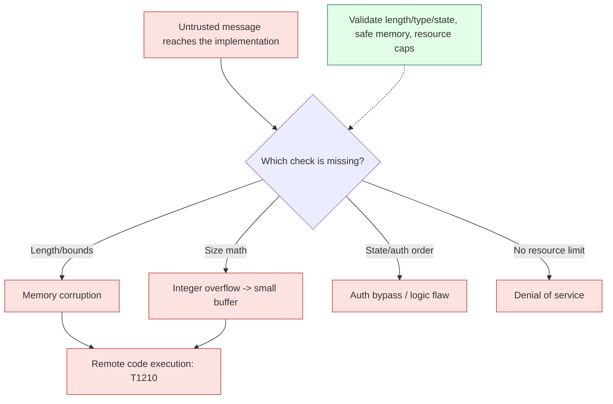

# Vulnerability Root Causes in Network Protocol Implementations

## Summary

Protocol vulnerabilities almost always come from a handful of recurring root causes in how an implementation handles untrusted input. Naming them makes testing systematic: instead of hunting randomly, you check each category against every field. A remotely reachable flaw of these kinds lets an attacker exploit the service over the network (exploitation of remote services, T1210). The underlying theme is the same as all input security — the implementation trusts a value it should have validated.

## The recurring root causes

| Root cause | What goes wrong |
|---|---|
| **Memory corruption** | Trusting a length/offset leads to buffer overflow, out-of-bounds read/write, use-after-free |
| **Integer bugs** | Overflow/underflow in size math produces undersized buffers or huge allocations |
| **Missing length/bounds checks** | Reading or copying more than the buffer holds |
| **State machine flaws** | Accepting messages out of order, or skipping authentication steps |
| **Injection / parsing confusion** | Delimiter or encoding ambiguity letting data act as commands or desync parsers |
| **Resource exhaustion** | No limits on size, count or recursion, enabling denial of service |
| **Trusting client-supplied values** | Using claimed identity, length or type without verification |

These map to common CWE classes and are found by combining code review, protocol modelling and fuzzing.

## From root cause to impact

## Detection

- Service crashes, restarts or memory-protection faults correlated with specific malformed messages.
- Messages with inconsistent length/size fields, extreme values, or out-of-sequence protocol states reaching the service.
- Abnormal resource use (memory, CPU, connection count) tied to crafted input.
- IDS signatures for known exploit patterns against specific protocol implementations.

## Defense

- **Validate every input**: length against actual data and sane bounds, type and state against what the protocol allows, before acting on it.
- **Use memory-safe languages or safe APIs**, and compile native code with mitigations (canaries, NX, ASLR).
- **Check size arithmetic** for overflow/underflow before allocating or copying.
- **Enforce the state machine**: reject messages that arrive before authentication or out of order.
- **Cap resources**: limit message size, nesting/recursion, and concurrent work to prevent exhaustion.
- **Fuzz and patch**: fuzzing finds these classes quickly; fix the root cause, then patch promptly.

## ATT&CK mapping

| ID | Name | Tactic |
|---|---|---|
| T1210 | Exploitation of Remote Services | Lateral Movement |

## Explanation

Nearly every protocol bug is the implementation believing something a stranger told it: "this message is ten bytes" when it is a thousand, "I already logged in" when it did not, "process this a million times." The categories are few, which is good news — you can walk the same short checklist against every field and every state. The fix is always the same shape: verify before you trust, keep memory safe, and put a ceiling on what one message can make you do.
