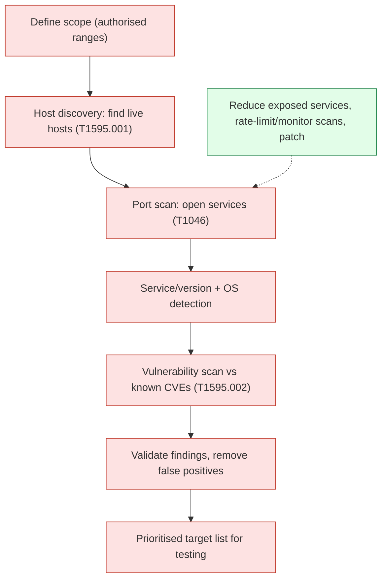

# Network Scanning and Vulnerability Discovery for Penetration Tests

## Summary

Before exploiting anything, a tester (or attacker) must know what exists: which hosts are up, which ports and services are open, and which of those have known weaknesses. **Network scanning** sweeps address ranges and ports to build that map (scanning IP blocks, T1595.001; network service discovery, T1046); **vulnerability discovery** matches the discovered services against known flaws (vulnerability scanning, T1595.002). The quality of everything that follows depends on this map being accurate and complete, which is why methodology matters more than any single tool.

## Stages of discovery

| Stage | Goal |
|---|---|
| **Host discovery** | Find live hosts in scope (ICMP, ARP, TCP/UDP probes) — T1595.001 |
| **Port scanning** | Determine open/closed/filtered ports per host (SYN, connect, UDP scans) — T1046 |
| **Service/version detection** | Identify the service and version behind each open port |
| **OS fingerprinting** | Infer operating systems from stack behaviour |
| **Vulnerability scanning** | Match services/versions to known CVEs and misconfigurations — T1595.002 |
| **Validation** | Manually confirm findings to remove false positives |

Scan types trade speed for stealth and accuracy: a SYN scan is fast and relatively quiet; a full-connect scan is reliable but noisy; UDP scanning is slow but necessary for services like DNS and SNMP.

## Flow

## Detection

- Sequential or dictionary sweeps across many IPs/ports from one source (classic scan signature).
- Bursts of connections to closed/filtered ports, or SYNs without completed handshakes.
- Known scanner fingerprints and user agents, and vulnerability-scanner probe patterns in logs.
- Spikes in ICMP, ARP, or UDP probe traffic.

## Defense

- **Minimise attack surface**: expose only required services, close or firewall everything else, and remove forgotten listeners.
- **Patch promptly** so that even a complete scan finds few exploitable versions.
- **Rate-limit and monitor** scanning behaviour, and alert on sweeps; IDS/IPS can flag or slow them.
- **Run your own authenticated scans** regularly, so you find and fix issues before an attacker's scan does.
- Remember scanning is reconnaissance, not exploitation: detection buys time, but reducing exposure and patching are the real defences.

## ATT&CK mapping

| ID | Name | Tactic |
|---|---|---|
| T1595.001 | Active Scanning: Scanning IP Blocks | Reconnaissance |
| T1595.002 | Active Scanning: Vulnerability Scanning | Reconnaissance |
| T1046 | Network Service Discovery | Discovery |

## Explanation

Scanning is making the map before the raid: walking the street to see which buildings are occupied, which doors and windows are open, and which locks are the old kind with a known flaw. The tester who draws an accurate map plans a precise test; the one who guesses wastes effort. For the defender, the lesson is that you cannot stop someone drawing a map of a public street, so the win is having fewer open windows and no old locks when they do.
