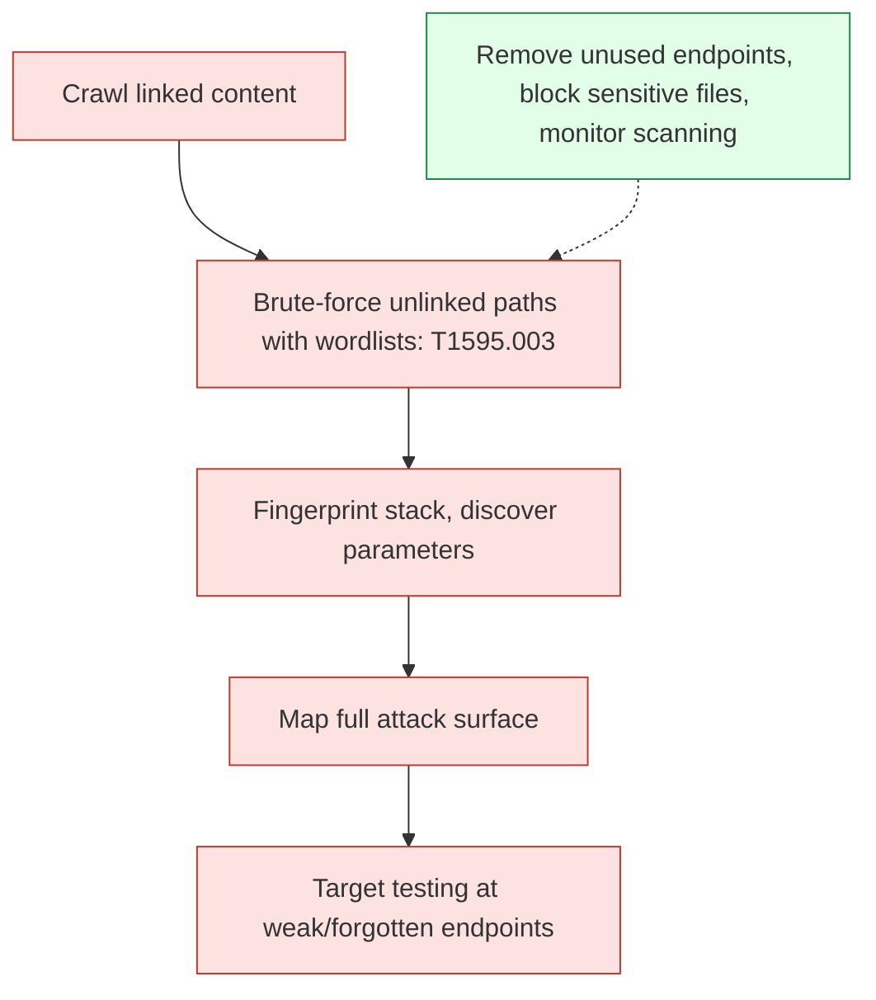

# Web Application Mapping and Content Discovery

## Summary

Before attacking a web application, testers and attackers map it: enumerate its pages, endpoints, parameters and technologies to build a picture of the attack surface. Content discovery finds the parts that are not linked from the visible site, which is often where weak or forgotten functionality lives. This is a reconnaissance activity (ATT&CK T1595.003 Wordlist Scanning, T1594 Search Victim-Owned Websites).

## What mapping covers

| Activity | Goal |
|---|---|
| **Crawling / spidering** | Follow links and forms to list reachable pages and parameters |
| **Directory and file brute forcing** | Use wordlists to find unlinked paths (`/admin`, `/backup`, `/api`, `.git/`) — ATT&CK T1595.003 |
| **Parameter discovery** | Find hidden query/body parameters the app accepts |
| **Technology fingerprinting** | Identify server, framework, CMS and library versions |
| **Virtual host / subdomain discovery** | Find other sites on the same infrastructure |
| **Robots/sitemap and source inspection** | `robots.txt`, `sitemap.xml`, JavaScript and comments reveal endpoints |
| **Passive OSINT** | Search engines, certificate transparency, public repos (T1596) |

The output is a map: every endpoint, parameter, technology and entry point, which then guides targeted testing.

## Flow

## Detection

- Bursts of 404s from wordlist-style path probing, or many requests enumerating sequential/dictionary paths (scanning signature).
- Requests for sensitive paths (`.git/`, `.env`, `/backup`, admin consoles).
- Unusual user agents and high request rates from a single source.

## Defense

- **Minimise attack surface**: remove or disable unused endpoints, test/staging pages, and default consoles.
- **Block access to sensitive files and directories** (source control, backups, config, `.env`), and disable directory listing.
- **Do not rely on obscurity**: an unlinked endpoint is still reachable, so protect it with authentication and authorization.
- **Monitor and rate-limit** scanning behaviour; alert on content-discovery patterns.
- Keep an accurate inventory of your own endpoints so forgotten functionality does not linger.

## ATT&CK mapping

| ID | Name | Tactic |
|---|---|---|
| T1595.003 | Active Scanning: Wordlist Scanning | Reconnaissance |
| T1594 | Search Victim-Owned Websites | Reconnaissance |
| T1596 | Search Open Technical Databases | Reconnaissance |

## Explanation

Mapping is drawing the floor plan before the break-in, including the doors that are not on the public tour. Content discovery is rattling every handle with a list of common door names to find the unmarked store room someone forgot to lock. The defense is to have fewer doors, lock the sensitive ones properly rather than just hiding them, and notice when someone is trying every handle.
