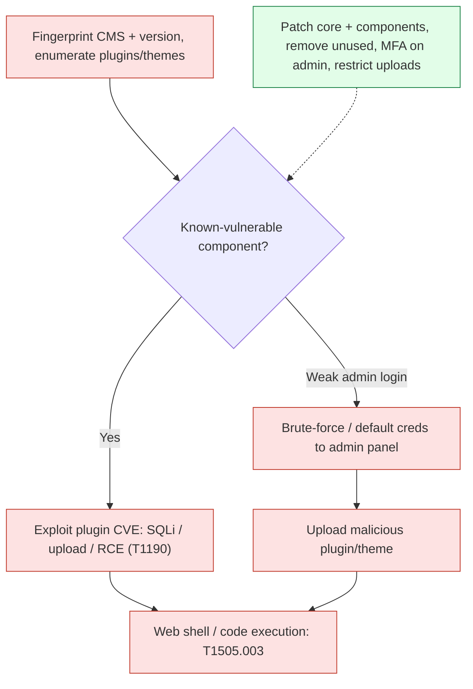

# Attacking Content Management Systems (CMS)

## Summary

A content management system (CMS) such as WordPress, Joomla or Drupal runs a large share of the web. The CMS core is usually well maintained, but the **third-party plugins, themes and extensions** bolted on top are not, and they run with the same privileges as the core. Most real-world CMS compromises are not a flaw in the core engine; they are an outdated, abandoned or misconfigured add-on reached through the public site (T1190), often ending in a web shell (T1505.003). This is the OWASP A06 "Vulnerable and Outdated Components" risk in concentrated form.

## Where CMS sites break

| Weak point | What it looks like |
|---|---|
| **Vulnerable plugin/theme** | A plugin with a public CVE enabling SQLi, file upload or RCE |
| **Outdated core** | Unpatched core version with a known exploit chain |
| **Weak admin credentials** | Default or guessable admin login, no MFA, exposed login page |
| **Exposed metadata** | Version numbers in `readme.html`, meta tags, or `/wp-json`; user enumeration |
| **Unrestricted file upload** | Media or plugin upload that accepts executable files, planting a web shell |
| **Misconfiguration** | Directory listing, backup files, exposed config, debug mode on |

## Attack flow

## Detection

- New or modified files in the web root, plugin or upload directories (core-file integrity monitoring).
- Scanner traffic enumerating `/wp-content/plugins/`, `readme.html`, or version paths.
- Logins from unusual locations, brute-force bursts against the admin page, or new admin accounts.
- Known-exploit request patterns against specific plugin endpoints.

## Defense

- **Keep the core, plugins and themes patched**, and enable auto-updates where feasible.
- **Install only what you need**, from reputable sources, and remove unused or abandoned components entirely (deactivating is not enough).
- **Protect the admin interface**: strong unique credentials, MFA, restrict the login page by IP or rate-limit it, and rename or hide default admin paths as defence in depth only.
- **Restrict file uploads** to expected types and store them without execute permission outside the code path.
- **Remove version leakage** and disable directory listing, debug output and leftover installer/backup files.
- **Monitor file integrity** so a planted web shell is noticed.

## ATT&CK mapping

| ID | Name | Tactic |
|---|---|---|
| T1190 | Exploit Public-Facing Application | Initial Access |
| T1505.003 | Server Software Component: Web Shell | Persistence |

## Explanation

A CMS is a house built from a solid frame plus a lot of cheap add-on rooms ordered from different suppliers. Burglars rarely break the frame; they find the one conservatory with a faulty latch (an unpatched plugin) and walk in. Because every room shares the same alarm and keys, one weak add-on gives run of the whole house. The fix is to fit fewer add-ons, keep every one serviced, and throw out the ones nobody uses.
