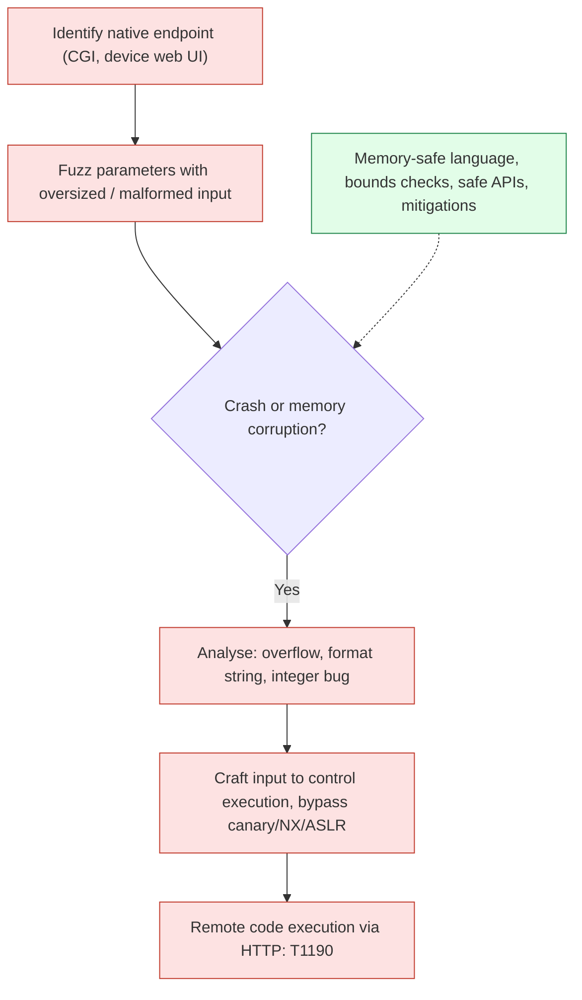

# Attacking Native Compiled Web Applications

## Summary

Most web applications run on managed runtimes (PHP, Java, .NET, Node, Python) where a single input bug causes a logical flaw. Some, however, are **native compiled binaries** written in C or C++: CGI programs, embedded-device web interfaces (routers, cameras, appliances), and custom server modules. These carry the managed web flaws **plus** memory-safety bugs. An input that a managed app would merely mishandle can, in a native binary, corrupt memory and lead to code execution over the public interface (T1190). The interesting target is usually the C code behind an unassuming CGI endpoint.

## Added attack surface versus managed apps

| Issue | Why native binaries are different |
|---|---|
| **Buffer overflow** | Unbounded copies (`strcpy`, `sprintf`, `memcpy` with attacker length) overwrite stack/heap |
| **Integer overflow/underflow** | A miscomputed size leads to undersized buffers and later overflow |
| **Format string** | User input used as a `printf` format can read or write memory |
| **Off-by-one / bounds errors** | Classic C indexing mistakes corrupt adjacent data |
| **Command/path handling** | `system()`/`exec` built from input gives command injection |
| **No managed guardrails** | No automatic bounds checks, garbage collection or type safety |

Exploitation mirrors binary exploitation: control a saved return address or function pointer, work around mitigations (stack canaries, NX/DEP, ASLR), and redirect execution — but the delivery is an HTTP request.

## Attack flow

## Detection

- Web-server or process crashes and restarts correlated with specific requests (segfaults in logs).
- Requests with abnormally long parameters, format specifiers (`%n`, `%x`), or binary payloads.
- Host-based protections firing on the web process: stack-smashing detection, DEP/NX violations.
- Unexpected child processes spawned by the web binary (sign of achieved execution).

## Defense

- **Prefer memory-safe languages** for new web components; keep native code to the minimum.
- **Validate length and content** of every input before copying, and use bounded, safe APIs (`snprintf`, `strncpy` used correctly, or safer string libraries).
- **Never pass user input as a format string**, and never build shell commands from input.
- **Compile with mitigations on**: stack canaries, NX/DEP, ASLR/PIE, FORTIFY_SOURCE, and RELRO; keep them enabled in production.
- **Fuzz native endpoints** during development and patch the underlying code, not just the symptom.
- **Patch embedded/appliance firmware**, where these bugs are common and long-lived.

## ATT&CK mapping

| ID | Name | Tactic |
|---|---|---|
| T1190 | Exploit Public-Facing Application | Initial Access |

## Explanation

A managed web app is a clerk who, handed a 500-page form for a 1-page slot, simply refuses it. A native binary is a clerk who starts copying page 501 onto the desk, then the floor, then over the building's wiring — and if an attacker chooses what goes on that wiring, they can rewire what the clerk does next. The defence is a desk that physically cannot overflow (bounds checks and memory-safe code) and alarms that trip the moment copying runs past the edge.
