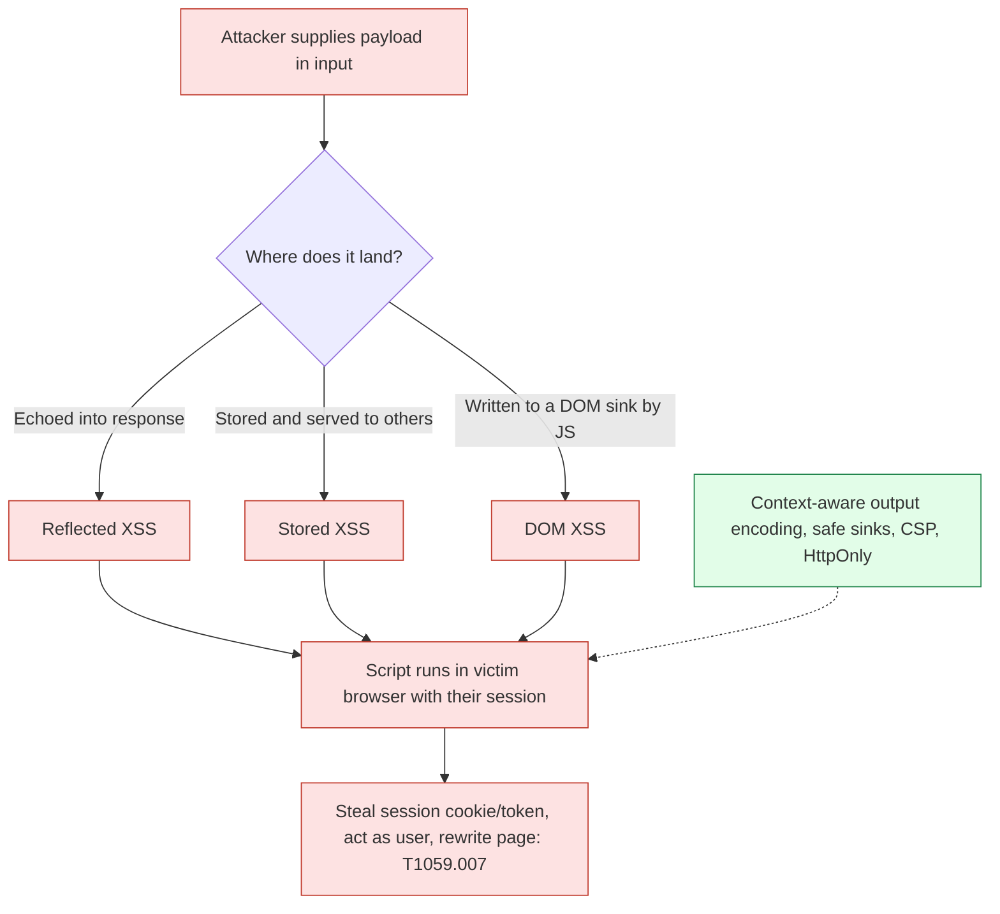

# Cross-Site Scripting (XSS)

## Summary

Cross-site scripting happens when an application puts untrusted data into a page in a way that lets the browser treat it as **code** rather than text. A comment that should appear as plain text instead runs as JavaScript or injects attacker-controlled HTML. The injected script runs in the victim's browser with the victim's session, so it can steal cookies and tokens, perform actions as the user, rewrite the page, or redirect them.

"Untrusted data" is anything the application did not create itself: form input, URL parameters, data other users stored, and responses from other services.

## Types

| Type | Where the untrusted data lives | How it reaches the victim |
|---|---|---|
| **Reflected** | In the request (for example a query parameter) and echoed straight into the response | The victim follows a crafted link or submits a crafted request |
| **Stored (persistent)** | Saved by the application (database, profile, comment) and served to others later | Any user who views the stored content |
| **DOM-based** | Processed entirely in the browser by client-side JavaScript that writes untrusted data into a dangerous sink | The vulnerable JavaScript runs on the victim's page |

## How it works

1. The attacker finds an input that is reflected into, or stored and later rendered in, a page (or a client-side script that writes input into a dangerous DOM sink).
2. They supply a payload that breaks out of the data context into a code context — for example closing an attribute and adding a `<script>` element, or supplying a `javascript:` URL.
3. When the page renders, the browser parses the payload as HTML/JavaScript and executes it.
4. The script acts with the victim's privileges: reading accessible cookies and tokens, calling application APIs as the user, or manipulating the page.

The root cause is a context mismatch: the browser parses HTML, JavaScript, URLs and CSS by different rules, and data placed into one of those contexts without the right encoding is interpreted as syntax.

## Attack flow

## Detection

- **Code and testing**: look for untrusted data flowing into HTML, attribute, JavaScript, URL or CSS contexts without context-appropriate encoding, and for dangerous DOM sinks (`innerHTML`, `document.write`, `eval`, `location`) fed by input.
- **Runtime**: WAFs and logging can flag classic payloads (`<script>`, `onerror=`, `javascript:`), but they miss DOM-based XSS that never reaches the server and are bypassable. Do not rely on them as the control.
- **CSP violation reports** can reveal injection attempts and misconfigurations.

## Defense

Per the OWASP XSS prevention guidance:

- **Prefer safe APIs** that treat data as text (for example `textContent` instead of `innerHTML`).
- **Context-aware output encoding**: encode untrusted data for the exact context it is placed in (HTML body, attribute, JavaScript, URL, CSS). Using the wrong encoding reintroduces the bug. Start with the framework's built-in automatic encoding.
- **HTML sanitization** when the app must accept user-authored HTML: use a maintained sanitizer such as DOMPurify, and keep it patched.
- **Avoid dangerous sinks**; even with encoding, placing variables into some contexts cannot be made safe.
- **Content Security Policy (CSP)** as defense in depth to limit what scripts can run.
- **Trusted Types** (where supported) to make DOM XSS sinks reject plain strings.
- **`HttpOnly` cookies** so script cannot read session cookies, reducing the impact of a successful XSS.
- Input validation enforces expected formats but does **not** replace output encoding.

## ATT&CK mapping

| ID | Name | Tactic |
|---|---|---|
| T1059.007 | Command and Scripting Interpreter: JavaScript | Execution |
| T1189 | Drive-by Compromise | Initial Access |

## Explanation

XSS is tricking a web page into reading the attacker's words aloud as instructions instead of printing them as text. The fix is the page always knowing the difference: when it shows something a user typed, it quotes it as text for that exact spot on the page, so the browser never mistakes a comment for a command.
