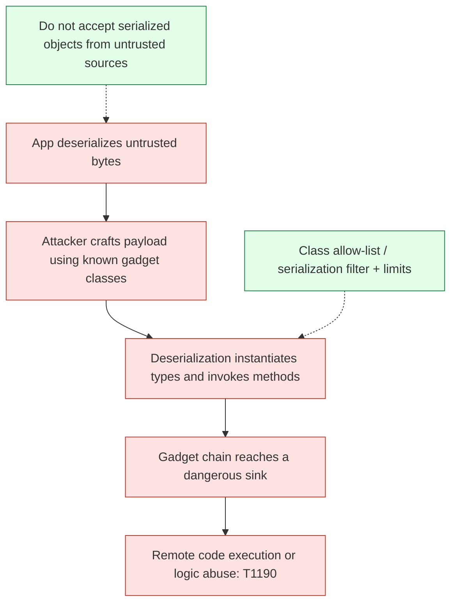

# Insecure Deserialization

## Summary

Serialization turns an object into a stream of bytes; deserialization rebuilds the object from those bytes. **Insecure deserialization** is deserializing data from an untrusted source without controls (CWE-502). Because deserialization can instantiate arbitrary types and invoke their methods, an attacker who controls the serialized data can, with the right "gadget" classes present, achieve remote code execution, or cause denial of service and logic abuse. The key principle from OWASP: **a deserializer can only instantiate types it knows about**, so restricting those types is the core defense.

## How it works

1. The application accepts serialized objects from users (a cookie, a hidden field, an API body, a message queue) and deserializes them.
2. The attacker crafts a serialized payload that, when rebuilt, chains together methods of classes already on the application's classpath — a **gadget chain** — to reach a dangerous operation (for example running a command).
3. Deserialization executes that chain, often before the application does any of its own validation.

Impact ranges from remote code execution (the worst case) to authentication bypass, privilege escalation through tampered object fields, and denial of service.

Native binary serialization (Java `ObjectInputStream`, .NET `BinaryFormatter`, Python `pickle`, PHP `unserialize`) is the most dangerous because it can reconstruct rich object graphs. Data formats like JSON are safer by default but still risky when a library is configured to embed and honour type information.

## Attack flow

## Detection

- Code and dependency review: untrusted data reaching a native deserializer, or a JSON/XML library configured to resolve types from the input.
- Known vulnerable libraries and gadget-bearing dependencies on the classpath.
- Runtime: deserialization errors, unexpected class loads, or process execution following receipt of serialized input.

## Defense

Per OWASP:

- **The best defense is not to accept serialized objects from untrusted sources**, and to use a simple data format (such as plain JSON without type embedding) for cross-trust-boundary data.
- Where deserialization of untrusted data is unavoidable, **restrict the types** that can be created: use a class **allow-list**. In Java, configure **serialization filters** with an application-specific allow-list and resource limits (graph depth, references, array lengths, stream bytes) before reading objects, and bound the input size separately. Filtering does not make arbitrary untrusted deserialization safe.
- In .NET, avoid `BinaryFormatter`; where a type-binding deserializer is used, constrain types with a custom `SerializationBinder` allow-list, and keep code that could form gadgets away from code that handles untrusted input.
- **Integrity-check** serialized data you must round-trip through the client (for example a digital signature) so tampering is detected, remembering this does not stop a trusted-but-malicious producer.
- Keep serialization libraries patched, since new gadget chains are found regularly.

## ATT&CK mapping

| ID | Name | Tactic |
|---|---|---|
| T1190 | Exploit Public-Facing Application | Initial Access |

## Explanation

Deserialization is handing someone a flat-pack kit and letting them rebuild any object from it. If you accept kits from strangers, a clever stranger sends a kit that, as it assembles, pulls levers already lying around your workshop until something dangerous happens. The safest rule is not to accept kits from strangers; if you must, only allow the exact few models you expect and cap how big the kit can be.
