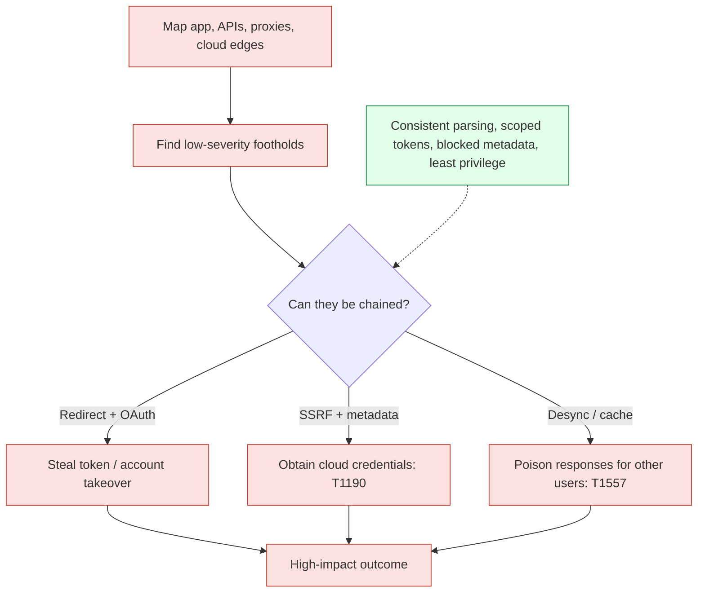

# Modern Web Application Attack Techniques for Red Teams

## Summary

Classic single-bug exploitation (one SQLi, one XSS) still matters, but modern web applications are distributed systems — SPAs, APIs, microservices, caches, proxies and cloud back ends — and their most impactful flaws live in the **seams between components** and in **chains of smaller issues**. A red team emulating a capable adversary looks for where two systems disagree, where a low-severity bug unlocks a high-severity one, and where the web front end is a path to cloud or internal infrastructure (T1190, with network-position attacks T1557). This file surveys that modern surface; each technique has its own detailed treatment elsewhere in this section.

## The modern surface

| Area | Representative techniques |
|---|---|
| **Request/response desync** | HTTP request smuggling, response queue poisoning between front-end and back-end |
| **Cache attacks** | Web cache poisoning and cache deception serving the wrong content to others |
| **Client-side at scale** | DOM-based XSS, prototype pollution, postMessage abuse, dependency/supply-chain in JS |
| **SSRF to cloud** | SSRF reaching internal services or cloud metadata endpoints for credentials |
| **Auth/identity** | OAuth/OIDC/SAML misconfigurations, JWT flaws, SSO trust abuse (see [SSO](../web-security/single-sign-on-security-issues.md)) |
| **API logic** | BOLA/IDOR, mass assignment, GraphQL abuse (see [API Hacking](../web-security/api-hacking-rest-graphql-authorization.md)) |
| **Chaining** | Low-impact bug (open redirect, self-XSS, CSRF) combined into account takeover or RCE |

The red-team mindset is **impact through combination**: an open redirect plus an OAuth flow becomes token theft; an SSRF plus a cloud metadata service becomes credentials; an IDOR plus a role field becomes privilege escalation.

## Chaining flow

## Detection

- Desynchronised or duplicated responses, and cache entries serving unexpected or user-specific content.
- Server-side requests from the app toward internal ranges or cloud metadata IPs (169.254.169.254 and equivalents).
- OAuth/SAML flows with unexpected redirect URIs or token audiences; JWTs with `alg:none` or unverified signatures.
- Sequences where a minor bug is immediately followed by a privileged action (chaining in the logs).

## Defense

- **Keep front-end and back-end request parsing consistent**, and configure caches to never cache sensitive or user-specific responses.
- **Block SSRF to internal and metadata addresses**, require authentication on internal services, and use least-privilege cloud roles so a reached credential is limited.
- **Harden identity flows**: exact redirect-URI matching, validated token audience and signature, short-lived scoped tokens.
- **Treat low-severity findings as chain links**, not noise; fix open redirects, self-XSS and CSRF rather than accepting them.
- **Defence in depth**: assume any single control can fail and ensure the next one limits blast radius.

## ATT&CK mapping

| ID | Name | Tactic |
|---|---|---|
| T1190 | Exploit Public-Facing Application | Initial Access |
| T1557 | Adversary-in-the-Middle | Credential Access, Collection |

## Explanation

An old-school attacker looks for one unlocked door. A modern red team maps the whole estate — the main house, the guest API, the delivery proxy, the cloud garage — and looks for where two guards hand off and disagree about who is allowed through, and for how a trivial win (a propped side gate) becomes a serious one (the keys to the garage). The defence is making the handoffs agree, keeping each key to one small job, and never treating a small open gate as harmless.
