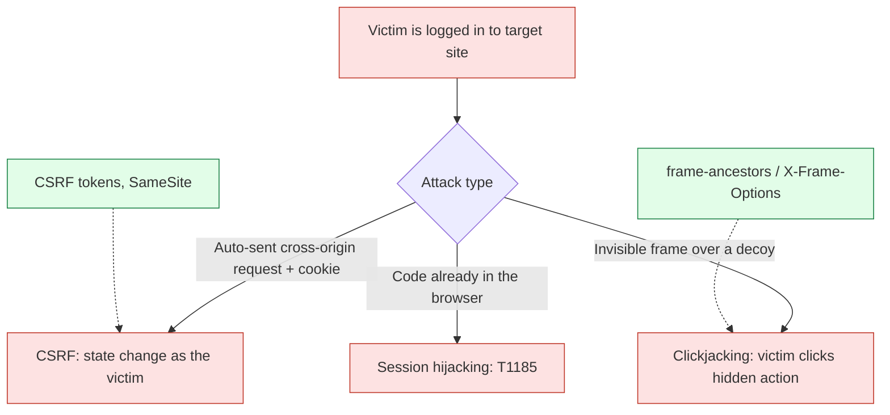

# Other Client-Side Attacks (CSRF, Clickjacking, Same-Origin Policy)

## Summary

Some web attacks target the **browser's trust model** rather than the server's parsing. The Same-Origin Policy (SOP) is the browser rule that keeps one site from reading another's data; CSRF and clickjacking are ways attackers abuse the gaps around it to make a victim's browser act against a site where they are logged in.

## Same-Origin Policy (the backdrop)

SOP restricts how a document or script from one **origin** (scheme + host + port) can interact with resources from another. It stops `evil.com` from reading responses from `bank.com` in the victim's browser. Crucially, SOP limits *reading* cross-origin responses, but it does **not** stop the browser from *sending* cross-origin requests (and attaching cookies) — which is the gap CSRF exploits. CORS is the controlled way a server opts in to some cross-origin access; misconfigured CORS re-opens what SOP protects.

## Cross-Site Request Forgery (CSRF)

CSRF makes a victim's browser send a **state-changing request** to a site where they are authenticated, without their intent. Because the browser automatically attaches the session cookie, the server sees a legitimate-looking request.

- Example: a hidden form on `evil.com` auto-submits a "change email" POST to `bank.com`; the victim's cookie rides along and the change succeeds.
- **XSS defeats all CSRF defenses**, so XSS must be fixed too.

**Defenses (OWASP):**
- Use the framework's built-in CSRF protection where available.
- Add **CSRF tokens** to all state-changing requests and validate them server-side: the **synchronizer token pattern** for stateful apps, **double-submit cookie** for stateless apps.
- For APIs that cannot use `<form>`, require a **custom request header** (which cross-site HTML cannot set without CORS permission).
- Set the **`SameSite` cookie attribute** on session cookies as defense in depth (careful not to scope the cookie to a parent domain).

## Clickjacking

Clickjacking tricks a user into clicking something different from what they perceive, by loading the target site in a transparent or disguised frame over attacker content. The victim thinks they click "play" but actually click "delete account" on the framed site.

**Defenses (OWASP):** stop your pages being framed by untrusted sites using the **`Content-Security-Policy: frame-ancestors`** directive (preferred), or the older **`X-Frame-Options`** header.

## Browser session hijacking

Where an attacker already has code running in the victim's browser (for example via XSS or a malicious extension), they can ride the authenticated session directly — ATT&CK T1185 (Browser Session Hijacking). CSRF and clickjacking are ways to get the browser to act without needing that foothold.

## Flow

## Detection

- CSRF: state-changing requests with off-site `Origin`/`Referer`, or missing/invalid anti-CSRF tokens.
- Clickjacking: your site being framed (monitor for missing `frame-ancestors`/`X-Frame-Options` on sensitive pages).
- Unusual actions performed by authenticated sessions that the user denies making.

## Defense

- CSRF tokens on all state-changing requests (synchronizer token or double-submit), `SameSite` cookies, and custom headers for APIs.
- `Content-Security-Policy: frame-ancestors` (or `X-Frame-Options`) to prevent framing.
- Narrow CORS configuration so SOP is not needlessly relaxed.
- Fix XSS, because it bypasses these browser-trust defenses.

## ATT&CK mapping

| ID | Name | Tactic |
|---|---|---|
| T1185 | Browser Session Hijacking | Collection |

## Explanation

These attacks abuse the fact that a browser carries your "logged-in" badge to every site automatically. CSRF is a stranger mailing a form in your name that the clerk honours because your badge is attached; clickjacking is covering the real button with a fake one so you press it by accident. The defenses make the clerk demand a secret token the stranger cannot know, and stop your pages being hidden under someone else's.
