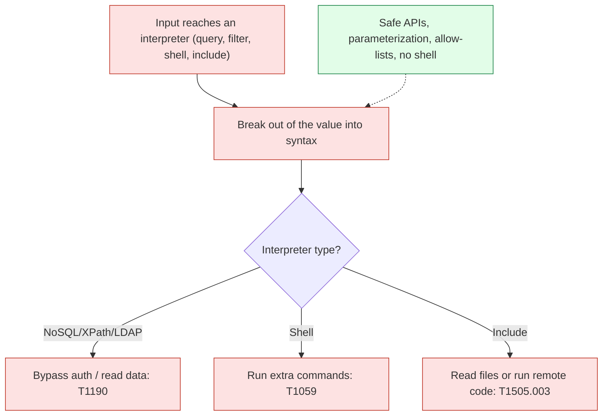

# Other Injection Attacks (NoSQL, XPath, LDAP, OS Command, File Inclusion)

## Summary

SQL injection is the famous case, but the same flaw appears wherever an application builds a command or query by mixing untrusted input with a syntax an interpreter will parse. If input can change structure instead of staying a value, it is injectable. This file covers the common non-SQL variants and the one defense they share: keep input as data, never as syntax.

## The variants

| Type | Interpreter | What the attacker achieves |
|---|---|---|
| **NoSQL injection** | MongoDB and similar query engines | Alters query objects/operators (for example injecting `$ne`, `$gt`, or a `$where` JavaScript expression) to bypass auth or read data |
| **XPath injection** | XML XPath queries | Breaks out of an XPath expression to read other nodes, often bypassing XML-based login |
| **LDAP injection** | LDAP directory filters | Manipulates the filter to bypass authentication or enumerate directory entries |
| **OS command injection** | A shell invoked by the app | Runs additional OS commands (ATT&CK T1059); can lead to a web shell (T1505.003) |
| **File inclusion (LFI/RFI)** | The app's file/include logic | Includes a local file (source/secrets) or, if remote inclusion is enabled, a remote file for code execution |
| **Argument injection** | A command invoked with user-controlled arguments | Adds extra flags/arguments that change what a trusted command does |

### OS command injection detail
If an app runs `ping <input>`, an attacker supplying `8.8.8.8; cat /etc/passwd` runs a second command. Even when the command name is fixed, **argument injection** lets input add dangerous flags (OWASP notes every OS command injection is also an argument injection).

### File inclusion detail
- **LFI**: the app includes a path built from input, letting an attacker traverse to sensitive files, read source, or in some stacks reach code execution (log poisoning, wrappers).
- **RFI**: if the platform allows including a remote URL, the attacker includes attacker-hosted code and runs it. Reaching a persistent web shell is ATT&CK T1505.003.

## Attack flow

## Detection

- Code review: input flowing into query objects, directory filters, shell calls (`system`, `exec`, backticks), or include/require paths.
- Runtime: shell processes spawned by the web app, unexpected file reads via traversal sequences (`../`), and outbound fetches for remote includes.
- Error messages revealing XPath/LDAP/NoSQL syntax problems.

## Defense

Per OWASP's injection guidance, the shared principle is to treat input as data:

- **Use safe, parameterized APIs** for every interpreter: parameterized database/NoSQL queries, parameterized LDAP/XPath APIs rather than string-built filters.
- **For OS commands, avoid calling the shell at all.** Prefer built-in library functions. Where a command is unavoidable, pass arguments as a list to an API that does not invoke a shell, and allow-list both the command and its arguments. Escaping (for example `escapeshellarg()`) helps but does not stop argument injection on its own.
- **For file inclusion**, never build include paths from input; map user choices to an allow-list, disable remote inclusion, and canonicalise and confine paths to prevent traversal.
- Apply least privilege so a successful injection does less.
- Validate input format as defense in depth, not as the primary control.

## ATT&CK mapping

| ID | Name | Tactic |
|---|---|---|
| T1190 | Exploit Public-Facing Application | Initial Access |
| T1059 | Command and Scripting Interpreter | Execution |
| T1505.003 | Server Software Component: Web Shell | Persistence |

## Explanation

All injection is the same trick in different languages: the app writes a sentence in some grammar (SQL, LDAP, shell, a file path) and lets the user supply a word, and the user supplies punctuation that turns their word into new grammar. The cure is always the same: hand the interpreter the structure and the values separately, so a value can never become an instruction.
