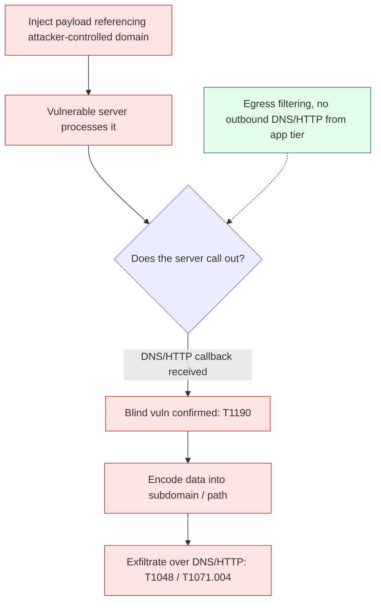

# Out-of-Band Exploitation and Blind Vulnerability Detection

## Summary

Some vulnerabilities return nothing useful in the HTTP response: a blind SQL injection, a blind XXE, a server-side request forgery, or command injection whose output is never shown. **Out-of-band (OOB) techniques** confirm and exploit these by making the vulnerable server reach out to a server the tester controls — over DNS or HTTP — so the proof arrives on a separate channel instead of in the page. The interaction confirms the bug (reaching the app is T1190) and can carry data out over that alternative channel (T1048), often via DNS (T1071.004). Burp Collaborator and `interactsh` are the common OOB listeners.

## Why a second channel is needed

| Situation | Why in-band fails | OOB signal |
|---|---|---|
| **Blind SQLi** | Query runs but results never render | DB makes a DNS/HTTP call to the tester's host |
| **Blind XXE** | Parsed entity output not reflected | External DTD/entity fetches an attacker URL |
| **SSRF** | Response body hidden or identical | Target server connects to the tester's listener |
| **Blind command injection** | Command output discarded | Injected `nslookup`/`curl` to a controlled domain |
| **Async/stored sinks** | Trigger and effect are separated in time | Delayed callback arrives later on the channel |

DNS is the most reliable channel because servers that cannot make arbitrary outbound HTTP can usually still resolve names, and the resolved subdomain can smuggle small amounts of exfiltrated data (T1071.004).

## Attack flow

## Detection

- Outbound DNS queries or HTTP requests from application/database servers to unfamiliar external domains.
- Long, random, or structured subdomains in DNS logs (a signature of DNS-based exfiltration).
- Server-initiated connections to addresses that app logic never legitimately contacts.
- Correlation of a received request/parameter with a near-simultaneous outbound callback.

## Defense

- **Restrict egress**: application and database tiers should not make arbitrary outbound DNS or HTTP connections; allow-list only required destinations.
- **Use an internal DNS resolver** and log/alert on queries to unknown external domains.
- **Disable external entity resolution** in XML parsers (prevents blind XXE OOB).
- **Fix the root bug**: parameterize queries, validate/deny SSRF targets (block internal ranges and metadata endpoints), and avoid passing input to shell commands.
- **Monitor DNS and proxy logs** as a detection layer for the exfiltration channel itself.

## ATT&CK mapping

| ID | Name | Tactic |
|---|---|---|
| T1190 | Exploit Public-Facing Application | Initial Access |
| T1048 | Exfiltration Over Alternative Protocol | Exfiltration |
| T1071.004 | Application Layer Protocol: DNS | Command and Control |

## Explanation

Some burglars leave no visible mark inside the house, so you cannot tell from the doorway that anything happened. The trick is to leave a payload that makes the house phone a number you own: when your phone rings, you know the break-in worked, and the digits dialled can even spell out what was taken. DNS is the phone line almost every house still has. The defence is to cut the house's ability to dial out at all, and to log every call it tries to place.
