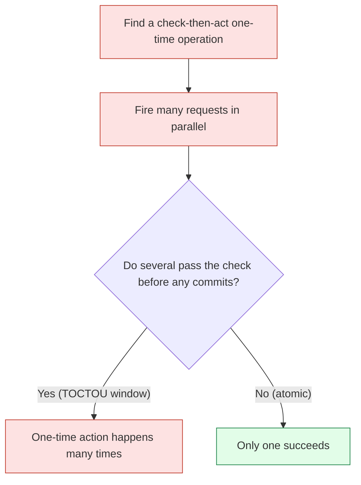

# Race Conditions in Web Applications

## Summary

A race condition is a flaw where the outcome depends on the timing of concurrent operations (CWE-362). In web applications it usually appears as a **time-of-check to time-of-use (TOCTOU)** gap (CWE-367): the application checks a condition, then acts on it, and an attacker slips a second request in between so the check and the action see different states. By sending many requests at nearly the same instant, an attacker can make a one-time action happen several times.

## How it works

The classic pattern:
1. The app checks a condition ("is this coupon unused?", "does the account have enough balance?").
2. It then performs an action based on that check (mark coupon used, deduct balance).
3. Between step 1 and step 2 there is a window. If two requests both pass step 1 before either reaches step 2, both proceed.

Sending requests in parallel (and tricks that align them, such as single-packet techniques) widens the effect. Common targets:

| Target | Abuse |
|---|---|
| Vouchers / coupons / gift cards | Redeem a single-use code many times |
| Account balance / withdrawals | Spend or withdraw more than the balance (double-spend) |
| Rate limits / quotas | Exceed a per-user limit by firing requests together |
| Stock / inventory | Buy more than are available |
| One-time actions | Trigger a "once only" operation repeatedly (e.g. applying a bonus) |

## Attack flow

## Detection

- Monitoring for outcomes that should be impossible: a single-use coupon redeemed more than once, balance going negative, quotas exceeded, more items sold than stock.
- Bursts of near-simultaneous identical requests from one user.
- Testing: send concurrent duplicate requests to one-time or limited operations and check whether more than one succeeds.

## Defense

The fix is to make the check-and-act **atomic** so no other request can interleave:

- Use **database transactions with appropriate isolation**, and enforce invariants with **atomic conditional updates** (for example, `UPDATE ... SET used = true WHERE id = ? AND used = false` and check that exactly one row changed) rather than read-then-write.
- Apply **unique constraints** and **row locks** (`SELECT ... FOR UPDATE`) so concurrent operations serialize.
- Use **idempotency keys** so a duplicated request has effect only once.
- Enforce limits and balances at the data layer where concurrency is controlled, not only in application code.

## ATT&CK mapping

No single ATT&CK technique applies; this is a concurrency flaw abused within application logic.

## Explanation

A race condition is two people reaching for the last seat and both being told "it's free" because the usher checked before either sat down. The app looks, says yes, then acts, and an attacker squeezes a second request into the pause. The cure is to make "check the seat and take it" a single, indivisible move so only one request can ever win.
