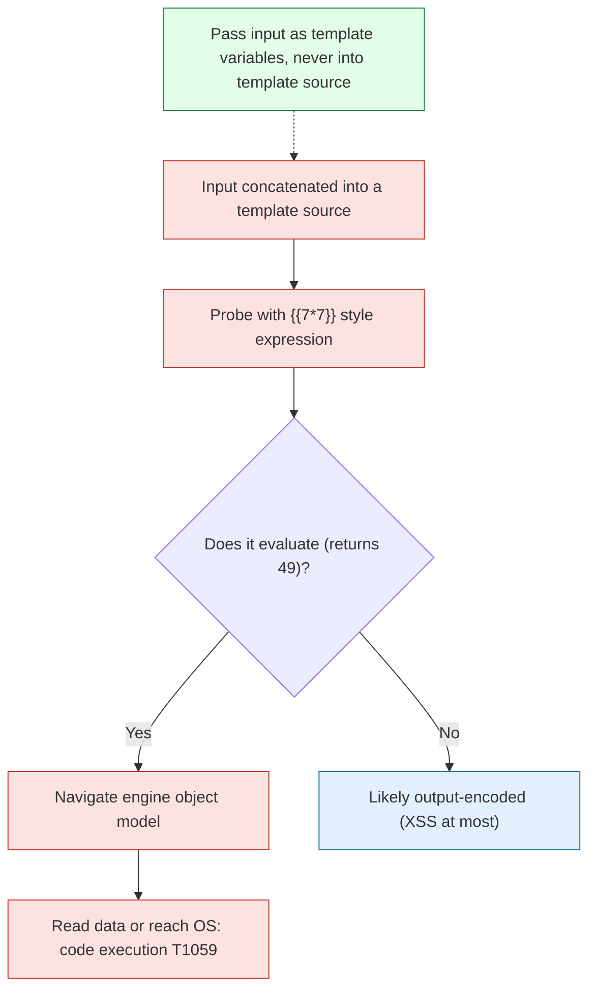

# Server-Side Template Injection

## Summary

Server-side template injection (SSTI) happens when user input is embedded directly into a server-side template that is then evaluated, so the input is parsed as **template code** rather than data (CWE-1336). Template engines are designed to execute expressions, so SSTI often leads to reading server data and, in many engines, remote code execution. It is distinct from XSS: XSS runs in the browser, SSTI runs on the server.

## How it works

Template engines (Jinja2, Twig, Freemarker, Velocity, ERB, Handlebars, and others) mix static text with expressions in delimiters such as `{{ ... }}` or `${ ... }`. The bug appears when an application builds the template string itself from input, for example:

```
render_template_string("Hello " + user_name)   # user_name goes into the template source
```

instead of passing the input as a **value** to a fixed template:

```
render_template("hello.html", name=user_name)  # safe: name is data
```

An attacker then supplies template syntax. A classic probe is a math expression like `{{7*7}}`; if the response contains `49`, the input is being evaluated as template code. From there the attacker navigates the engine's object model to reach built-ins, the environment, or OS access, depending on the engine, frequently achieving code execution (ATT&CK T1059) and server compromise.

## Attack flow



## Detection

- Code review: any place the application builds a template string from input, or calls a "render from string" API with input in it.
- Testing: submit engine-specific expressions (for example `{{7*7}}`, `${7*7}`, `<%= 7*7 %>`) and look for the evaluated result rather than the literal text.
- Runtime: template-engine errors referencing attacker input, or process execution following template rendering.

## Defense

- **Never build the template source from untrusted input.** Use fixed templates and pass input as **data/variables** to the engine, so it is rendered, not executed.
- If users must supply templates (rare), use a **sandboxed/logic-less engine** (such as a strictly limited or logic-less template language) and treat the sandbox as a hardening measure, not a guarantee, since engine sandboxes have been escaped.
- Run the rendering service at **least privilege** and isolate it, so code execution is contained.
- Keep template engines patched.

## ATT&CK mapping

| ID | Name | Tactic |
|---|---|---|
| T1190 | Exploit Public-Facing Application | Initial Access |
| T1059 | Command and Scripting Interpreter | Execution |

## Explanation

A template engine is a mail-merge tool: it fills blanks in a letter with values. SSTI is letting the sender write into the letter's instructions, not just the blanks, so the engine runs whatever formula they insert. The fix is to always hand the engine a fixed letter plus separate values, so the user can fill blanks but never rewrite the instructions.
