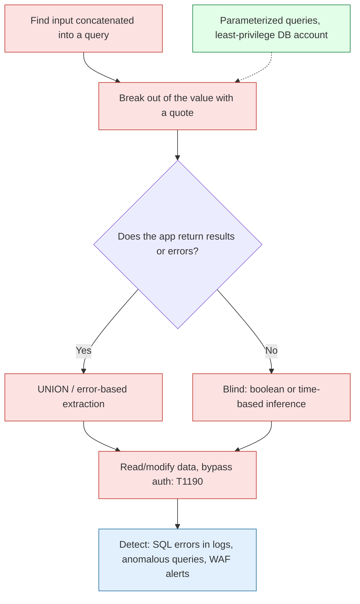

# SQL Injection

## Summary

SQL injection (SQLi) happens when an application builds a SQL query by concatenating untrusted input into the query string, so that input can change the **structure** of the query instead of being treated as a **value**. An attacker uses this to read or modify data they should not, bypass authentication, or in some cases run commands on the database host. It remains one of the highest-impact web vulnerabilities (CWE-89).

## How it works

Consider a login that builds:
```
SELECT * FROM users WHERE user = '<input>' AND password = '<input>'
```
If the application inserts the raw input, an attacker supplying `' OR '1'='1' -- ` as the username turns the query into one that is always true and ignores the password. The quote breaks out of the value; the rest is read as SQL syntax.

From that foothold, common techniques are:

| Technique | What it does |
|---|---|
| In-band / error-based | Reads data directly from results or database error messages |
| UNION-based | Appends `UNION SELECT` to pull data from other tables |
| Boolean-blind | Infers data one true/false question at a time from how the page responds |
| Time-based blind | Infers data from deliberate delays (`SLEEP`, `WAITFOR`) when no output is returned |
| Out-of-band | Makes the database call out to an attacker server to exfiltrate data |

Impact depends on the database account's privileges: at worst, reading all data, modifying or deleting it, bypassing auth, or reaching the OS through database features.

## Attack flow



## Detection

- Database and application logs showing SQL syntax errors, unusual `UNION`/`OR 1=1` patterns, or queries returning far more rows than normal.
- Time-based attacks show as repeated slow queries with deliberate delays.
- WAFs catch classic payloads but are bypassable and are not a substitute for fixing the code.
- Source review: any query string built by concatenating input is a finding.

## Defense

The fix is to separate code from data so input can never change query structure. Per OWASP:

- **Use parameterized queries (prepared statements)** for all dynamic values, with placeholders (`?`) bound by the driver. This is the primary defense.
- For **structural parts that cannot be parameterized** (table names, column names, sort direction), map the user's choice to a **strict allow-list** of fixed, application-owned values.
- **Do not rely on manual escaping**; it is error-prone and strongly discouraged.
- **Least-privilege database account** so a successful injection can do as little as possible.
- Stored procedures can help only if they themselves use parameters and do not build dynamic SQL from input.
- Input validation (expected type/format) is useful defense in depth but does not replace parameterization.

Detailed, per-tech defense is in [SQL Injection Prevention and Defensive Solutions](../web-security/sql-injection-prevention-and-defensive-solutions.md).

## ATT&CK mapping

| ID | Name | Tactic |
|---|---|---|
| T1190 | Exploit Public-Facing Application | Initial Access |

## Explanation

A query built by gluing user input into a sentence is like reading a form aloud where the "name" box might contain extra instructions. The attacker writes instructions in the name box, and the database obeys them. Parameterized queries hand the database the sentence and the values separately, so whatever is in the box is always just a value, never a command.
