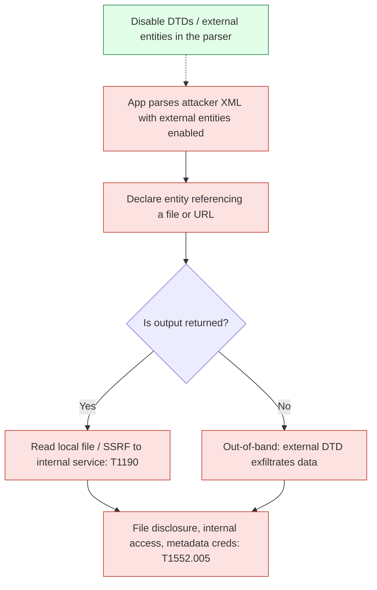

# XML External Entity (XXE) Injection

## Summary

XXE injection occurs when an XML processor resolves an **external entity** defined in untrusted input (CWE-611). XML lets a document declare entities, including ones that pull in external resources through a Document Type Definition (DTD). If a parser processes attacker-supplied XML with external entity resolution enabled, the attacker can read local files, make the server send requests to internal systems (SSRF), or exhaust resources. The fix is almost always a parser configuration change.

## How it works

An attacker submits XML that declares an external entity and references it:

- **File disclosure**: an entity pointing at a local file (for example a system file) is expanded into the parsed output, which the application then returns or acts on.
- **SSRF**: an entity pointing at an internal URL makes the server fetch it, which can reach internal services or a cloud metadata endpoint (see [SSRF and the Cloud Metadata API](../../cloud/web-security/ssrf-and-cloud-metadata-api.md), ATT&CK T1552.005).
- **Blind / out-of-band**: when output is not returned, the attacker uses an external DTD to make the parser send the data to an attacker-controlled server.
- **Denial of service**: nested entity expansion ("billion laughs") can exhaust memory and CPU.

Anywhere the application accepts XML is a candidate: SOAP, SAML, XML APIs, document formats (DOCX, SVG, XLSX) and file uploads that are really XML.

## Attack flow

## Detection

- Code and dependency review: XML parsers used with default or insecure configuration, especially those that process user-supplied documents.
- Testing: submit XML with a benign external entity (for example pointing at an attacker-controlled host) and watch for the callback (out-of-band) or file content in the response.
- Outbound requests from the application to unexpected internal or external hosts triggered by XML input.

## Defense

Per OWASP, the reliable fix is parser configuration:

- **Disable DTDs entirely where possible** — reject `DOCTYPE` declarations. For many Java parsers this is the feature `http://apache.org/xml/features/disallow-doctype-decl` set to `true`.
- If DTDs are genuinely required, **disable external entity resolution and external DTD loading**, and limit entity expansion.
- **Keep XInclude disabled** unless explicitly needed, as it can load resources independently of DTDs.
- Prefer less complex data formats such as JSON where XML is not required.
- Patch and configure every XML-processing library; exact settings are parser-specific, so apply them to each parser the application uses, not just one.

## ATT&CK mapping

| ID | Name | Tactic |
|---|---|---|
| T1190 | Exploit Public-Facing Application | Initial Access |
| T1552.005 | Unsecured Credentials: Cloud Instance Metadata API | Credential Access |

## Explanation

XML lets a document say "insert the contents of this file or URL here." XXE is an attacker putting that instruction in a document you parse, so your server fetches a local file or an internal address and hands it back. The cure is simple and decisive: tell the XML parser to stop obeying those "go fetch" instructions at all.
