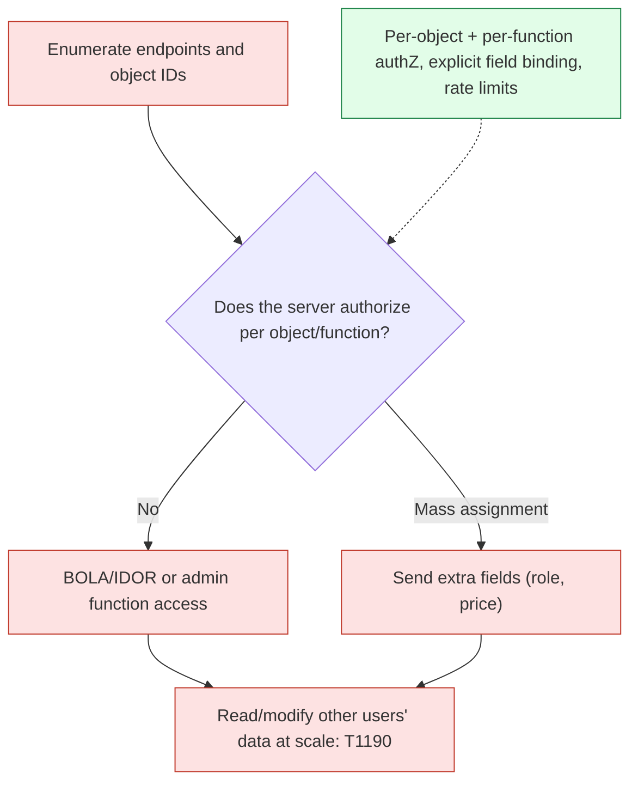

# API Hacking (REST, GraphQL and Authorization Flaws)

## Summary

Modern applications expose much of their functionality as APIs (REST and GraphQL) consumed by web and mobile front ends. APIs carry the same vulnerability classes as web pages, but their most common and damaging problems are **authorization** flaws: because each endpoint operates directly on objects and functions, a missing or weak access check exposes data at scale. The OWASP API Security Top 10 puts broken object-level and function-level authorization at the top.

## Where APIs break

| Issue (OWASP API Top 10 themes) | What it looks like |
|---|---|
| **Broken Object Level Authorization (BOLA/IDOR)** | `GET /api/orders/123` returns any order because ownership is not checked |
| **Broken Function Level Authorization** | A normal user calls an admin-only method the server does not gate by role |
| **Broken Object Property Level Authorization** | Mass assignment: sending extra fields (`"role":"admin"`) that the server blindly binds; or over-returning sensitive properties |
| **Broken Authentication** | Weak or missing token validation (see [SSO](single-sign-on-security-issues.md), [Authentication Attacks](authentication-attacks-web.md)) |
| **Unrestricted resource consumption** | No rate limiting or paging, enabling abuse and denial of service |
| **Injection** | The usual SQL/NoSQL/command injection through API parameters |
| **GraphQL-specific** | Deeply nested or recursive queries exhausting resources; introspection exposing the schema; batching to bypass rate limits |

## Attack flow

## Detection

- One account accessing object IDs across many users, or calling privileged methods.
- Requests carrying unexpected fields (role, price, ownership) that succeed.
- GraphQL queries with extreme depth/breadth, introspection queries in production, or batched queries used to defeat rate limits.
- Abnormal request volumes against a single endpoint.

## Defense

- **Authorize every request at both object and function level**, server-side, checking ownership and role, not just authentication (see [Broken Access Control](broken-access-control.md)).
- **Bind only expected fields** (allow-list of writable properties) to prevent mass assignment, and return only the properties the caller may see.
- **Validate and parameterize** all inputs against injection.
- **Rate-limit and paginate**; cap request size and, for GraphQL, query depth/complexity and disable introspection in production.
- **Validate tokens fully** and scope them narrowly.
- Treat the API, not the UI, as the security boundary: the front end is just one client.

## ATT&CK mapping

| ID | Name | Tactic |
|---|---|---|
| T1190 | Exploit Public-Facing Application | Initial Access |

## Explanation

An API is the building's service counter with no lobby staff: each request walks straight up and asks for a specific record or action. If the clerk hands over whatever record number you name without checking it is yours, one curious user can page through everyone's files. API security is mostly the clerk checking, for every single request, that you are allowed this exact object and this exact action.
