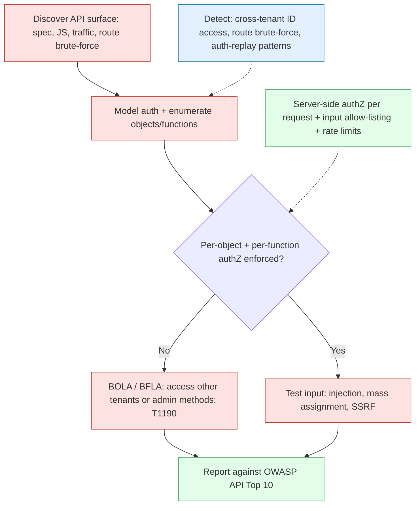

# API Penetration Testing Methodology and Tooling

## Summary

An API penetration test follows the same arc as a web-app test but is weighted toward **authorization** rather than rendered-page flaws: discover the endpoints and their object/function space, understand the auth model, then probe each operation for missing per-object and per-function checks, injection, and resource-consumption abuse. The reference map is the **OWASP API Security Top 10 (2023)**. This file is the methodology and the open-source toolchain that supports it, written so defenders can reproduce the assessment and detect the traffic it generates. It complements the concept-level [API Hacking (REST, GraphQL and Authorization Flaws)](api-hacking-rest-graphql-authorization.md) overview.

## OWASP API Security Top 10 (2023) as a test map

| ID | Risk | What the tester checks |
|---|---|---|
| API1 | Broken Object Level Authorization (BOLA) | Swap object IDs across accounts; does the server check ownership? |
| API2 | Broken Authentication | Token validation, weak/absent auth, credential-stuffing resistance |
| API3 | Broken Object Property Level Authorization | Mass assignment (extra writable fields) and over-returned sensitive properties |
| API4 | Unrestricted Resource Consumption | Missing rate limits, paging, size caps |
| API5 | Broken Function Level Authorization (BFLA) | Call admin/privileged methods as a low-priv user |
| API6 | Unrestricted Access to Sensitive Business Flows | Automatable abuse of flows (purchase, signup) at scale |
| API7 | Server Side Request Forgery | API fetches attacker-supplied URLs |
| API8 | Security Misconfiguration | Verbose errors, CORS, missing hardening, default creds |
| API9 | Improper Inventory Management | Shadow/old API versions, undocumented endpoints |
| API10 | Unsafe Consumption of APIs | Blind trust of data from third-party/upstream APIs |

## Methodology

1. **Discover the API surface.** Collect the OpenAPI/Swagger spec, Postman collections, mobile-app and SPA JavaScript, and traffic. Where no spec exists, brute-force routes and parameters (content discovery) and watch the app's own calls.
2. **Model the auth.** Identify the scheme (session cookie, API key, OAuth2 bearer/JWT), where tokens are issued and validated, and what scopes/roles exist. See [JWT and API Token Security](jwt-and-api-token-security.md).
3. **Map objects and functions.** Enumerate object IDs and the full method set (including undocumented verbs and versions — API9).
4. **Test authorization first.** For every object endpoint, attempt access across tenants/users (BOLA); for every privileged function, attempt it as a lesser role (BFLA). These are the highest-yield API findings.
5. **Test input and properties.** Injection through parameters, mass assignment of unexpected fields, and over-exposure of sensitive properties (API3).
6. **Test resilience.** Rate limiting, pagination, payload-size and complexity limits (API4/API6), SSRF (API7).
7. **Report** each finding against the OWASP API risk and a concrete server-side fix.

## Tooling

| Tool | Role |
|---|---|
| **Burp Suite / OWASP ZAP** | Intercepting proxy; repeater/intruder for ID swapping, fuzzing, auth testing |
| **Postman / Insomnia** | Drive documented endpoints, manage tokens and environments |
| **ffuf / feroxbuster** | Content and parameter discovery (routes, versions) |
| **kiterunner** (Assetnote) | API-route brute-forcing using real-world API wordlists (handles non-standard methods/paths) |
| **Arjun** | HTTP parameter discovery (find hidden query/body params) |
| **mitmproxy** | Capture and replay mobile/SPA API traffic |
| **nuclei** | Templated checks for known API misconfigurations and exposures |
| **jwt_tool** | JWT analysis and attack testing (see token file) |
| **Autorize / AuthMatrix** (Burp extensions) | Automate BOLA/BFLA testing by replaying requests under a second identity |

## Flow

## Detection

- **Content/route brute-forcing**: high 404/401 volume and sequential path probing (kiterunner, ffuf) against API prefixes.
- **BOLA probing**: one session accessing object IDs belonging to many users/tenants, or sequential/parameter-swept IDs.
- **BFLA probing**: a low-privilege token repeatedly calling admin-only methods and receiving 403s, then a 200.
- **Auth-replay tools** (Autorize) generate paired requests under two identities — a recognisable duplicate-request pattern.
- Spikes against a single endpoint (resource-consumption testing) and requests to deprecated API versions (shadow inventory).

## Defense

- **Authorize every request server-side at object and function level** — never rely on the client hiding a button or endpoint (see [Broken Access Control](broken-access-control.md)).
- **Allow-list writable properties** and return only properties the caller may see.
- **Rate-limit, paginate, and cap** payload size and query complexity.
- **Maintain an API inventory**; retire old versions and shadow endpoints (API9).
- **Centralise and fully validate tokens**, scope them narrowly, and log auth decisions so the probing patterns above are visible.

## ATT&CK mapping

| ID | Name | Tactic |
|---|---|---|
| T1190 | Exploit Public-Facing Application | Initial Access |
| T1078 | Valid Accounts | Initial Access, Persistence, Privilege Escalation, Defense Evasion |

## Explanation

Testing an API is mostly about asking the same question in a hundred small ways: "will you let me touch something that isn't mine, or do something I'm not allowed to?" There's no webpage to look at, just a list of operations, so the tester first builds that list — from the app's documentation, from the JavaScript the browser downloads, or by guessing paths with specialised wordlists — and then, for every operation, tries it as the wrong user or with an ID belonging to someone else. The tools (Burp, Postman, kiterunner, the Autorize extension) exist to make that repetition fast and to replay each request as a second identity automatically. For the defender it reduces to one rule the server must never skip: check, on every single request, that this caller is allowed this exact object and this exact action — and keep a log, because the test looks like one account quietly reaching for everybody else's.
