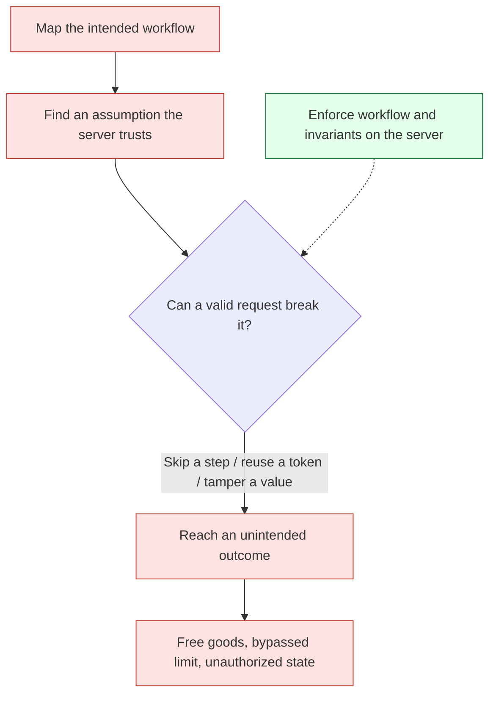

# Application Logic Flaws

## Summary

A business-logic (application-logic) flaw is a defect in how an application's intended workflow is designed or enforced, rather than a classic injection or memory bug (CWE-840). The input may be perfectly valid; the problem is that the application allows a sequence of legitimate actions to produce an outcome the designer never intended, such as getting goods for free, skipping a required step, or abusing a limit. Scanners rarely find these, because every individual request looks normal.

## Common patterns

| Pattern | Example |
|---|---|
| Skipping steps | Jumping straight to the "order confirmed" endpoint without paying |
| Negative or extreme values | Quantity of `-1` to credit an account; huge values to trigger overflow or free shipping |
| Price/total manipulation | Changing a price or discount the server trusts from the client |
| Replay / reuse | Reusing a one-time coupon, voucher or token multiple times |
| Insufficient limits | No cap on transfers, withdrawals, or resource use |
| Flawed state machine | Reaching a state (refund, approval) through a path that skips checks |
| Trusting workflow assumptions | Assuming step B always follows step A, when an attacker can call B directly |

The common thread: the application assumes users follow the happy path, and an attacker takes a different but still-valid route.

## Attack flow

## Detection

- Logic flaws are found mostly by **manual testing and threat modelling**, not scanners. Walk each workflow and ask "what if the user does this out of order, repeats it, or supplies an extreme value?"
- Monitoring: transactions with impossible values (negative amounts), coupons/tokens used more than allowed, workflows completing without their prerequisite events.

## Defense

- **Enforce the workflow and its invariants on the server**: required steps happened, in order, exactly once; values are within sane bounds; totals and prices come from authoritative server data, not the client.
- **Make one-time things one-time** server-side (coupons, tokens, state transitions), with atomic checks to avoid race conditions (see [Race Conditions in Web Applications](../exploitation/race-conditions-in-web-applications.md)).
- **Threat-model each feature**: list the assumptions, then test what happens when each is violated.
- Apply limits (amounts, rates, quantities) and re-check them server-side.
- Build abuse cases into testing, not just functional cases.

## ATT&CK mapping

No single ATT&CK technique applies; business-logic abuse is application-specific and chains legitimate requests.

## Explanation

Logic flaws are winning a game by following rules the designer forgot to write down. Every move is legal, but the sequence does something unintended, like checking out without paying because the "pay" step was only ever assumed, not required. The defense is to stop assuming users take the happy path and to have the server insist on each rule, in order, every time.
