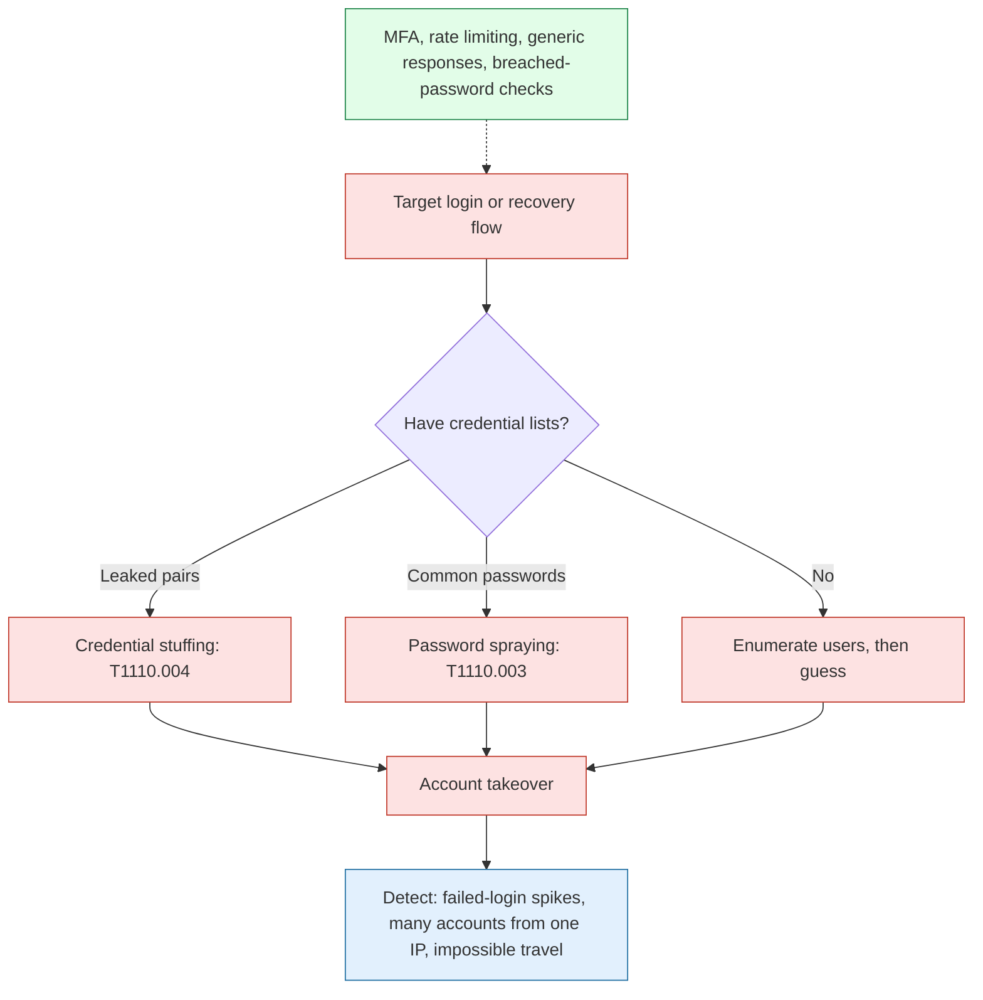

# Authentication Attacks (Web)

## Summary

Authentication is proving you are who you claim to be. Web authentication attacks aim to defeat that check: guessing or reusing credentials, abusing weak recovery flows, or exploiting mistakes that let an attacker in without the right password. Most map to ATT&CK T1110 (Brute Force) and its sub-techniques.

## Common attacks

| Attack | How it works | ATT&CK |
|---|---|---|
| **Password guessing** | Try likely passwords against one account | T1110.001 |
| **Password spraying** | Try a few common passwords across many accounts, staying under lockout thresholds | T1110.003 |
| **Credential stuffing** | Replay username/password pairs leaked from other breaches | T1110.004 |
| **Brute force** | Exhaustively try passwords where no rate limiting stops it | T1110 |
| **Username enumeration** | Use different responses/timing for valid vs invalid users to build a target list | — |
| **Weak password recovery** | Guessable security questions, predictable reset tokens, or reset links that leak | — |
| **Default / weak credentials** | Unchanged admin passwords | — |
| **MFA weaknesses** | MFA not enforced, bypassable, or defeated by prompt bombing | — |

## Attack flow

## Detection

- Spikes in failed logins, one IP touching many accounts (spraying), or many IPs hitting one account.
- Logins succeeding with credentials seen in known breaches.
- Timing or message differences between valid and invalid usernames (enumeration).
- Impossible travel and new-device logins for the same account.

## Defense

Per OWASP and NIST SP 800-63B:

- **Enforce MFA**, ideally phishing-resistant, especially for privileged accounts.
- **Rate-limit and throttle** authentication and recovery endpoints; add progressive delays or lockouts that resist spraying without enabling denial of service.
- **Screen passwords against breach/blocklists** rather than imposing composition rules. NIST recommends length and blocklist checks over character-composition rules: minimum length (shorter than 8 is weak with MFA, shorter than 15 without), allow up to at least 64 characters and all characters including spaces and unicode, and do not force upper/lower/number/special mixes.
- **Return generic responses** for login and recovery (do not reveal whether a username exists), and keep timing uniform.
- **Store passwords with a strong, salted password hash** (see password storage guidance).
- **Secure recovery**: high-entropy, single-use, expiring reset tokens; no guessable security questions.
- Protect against credential stuffing with MFA, bot detection and breached-credential checks.

## ATT&CK mapping

| ID | Name | Tactic |
|---|---|---|
| T1110 | Brute Force | Credential Access |
| T1110.003 | Password Spraying | Credential Access |
| T1110.004 | Credential Stuffing | Credential Access |

## Explanation

Passwords are a shared secret, and attackers rarely "break" them so much as reuse ones already leaked or try the handful everyone picks. The strongest single defense is a second factor, so a known password alone is not enough, backed by rate limits and silence about which usernames are real so attackers cannot even build a target list cheaply.
