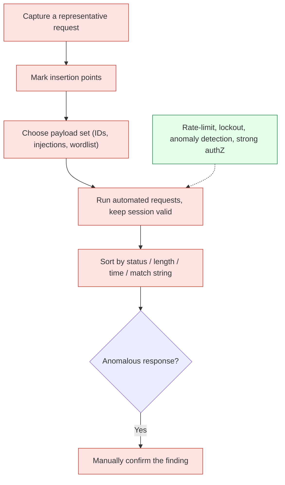

# Automating Customized Web Attacks (Fuzzing with Burp)

## Summary

Many web tests cannot be done by hand: checking thousands of IDs for broken access control, trying hundreds of injection payloads per parameter, or brute-forcing credentials needs automation. **Fuzzing** is sending many crafted or malformed inputs to a target and watching which responses differ, revealing error-prone or unguarded handling. Burp Suite's Intruder (and comparable tools such as `ffuf` or `wfuzz`) automate this against chosen insertion points. For the authorised tester it is how coverage scales; the same behaviour seen from outside is active scanning (T1595).

## Core ideas

| Concept | Meaning |
|---|---|
| **Insertion point** | The exact spot in a request where payloads are substituted |
| **Payload set** | The list of values to try (IDs, injection strings, wordlists, credentials) |
| **Attack shape** | One point iterated, one payload across many points, or multiple points in combination |
| **Response signal** | What marks a hit: status code, length, response time, or a string in the body |
| **Session handling** | Keeping tokens/CSRF valid so automated requests stay authenticated |

The skill is less "run the tool" and more **reading the signal**: a differing length or timing separates a vulnerable parameter from a safe one.

## Workflow

## Detection

- High request volume to one endpoint with systematically varying parameters (fuzzing signature).
- Many requests differing only in a single field (sequential IDs, dictionary values).
- Bursts of 4xx/5xx responses, or repeated auth failures from one source.
- Known scanner/tool user agents or request timing that is too regular for a human.

## Defense

- **Rate-limit and throttle** per account and per source; apply lockout or progressive delays on repeated failures.
- **Enforce authorization server-side** so iterating IDs reveals nothing the caller may not access.
- **Normalise responses**: avoid leaking success/failure through subtle length, timing or message differences (for example in login and password-reset flows).
- **Monitor and alert** on content-discovery and fuzzing patterns, and feed them to a WAF as one layer.
- Remember these controls slow automation but never replace correct authorization and input handling.

## ATT&CK mapping

| ID | Name | Tactic |
|---|---|---|
| T1595 | Active Scanning | Reconnaissance |

## Explanation

Testing a web app by hand is trying one key in one lock. Fuzzing is a machine that tries ten thousand keys a minute in every lock and flags the ones where the handle moved even slightly differently. For an authorised tester that is how you cover a large building before lunch. The defence is not an unpickable lock alone but also a guard who notices someone running a key-machine down the corridor, and locks that give nothing away by how they rattle.
