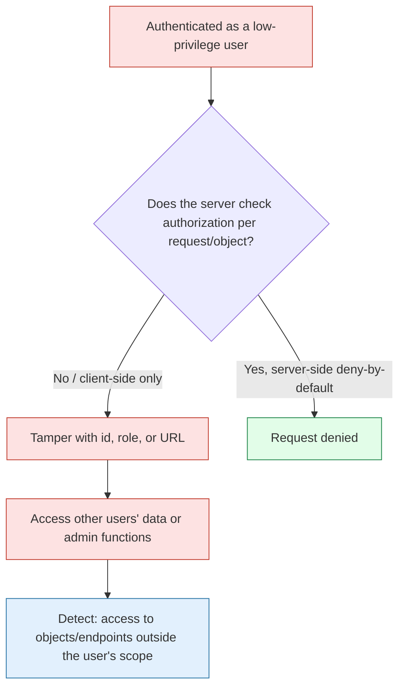

# Broken Access Control

## Summary

Access control (authorization) decides **what an authenticated user is allowed to do**. Broken access control is when those checks are missing, incomplete, or enforced only in the client, so a user can act outside their intended permissions: read other users' data, reach admin functions, or change records they do not own. It has repeatedly been the top category in the OWASP Top 10 (A01 in both 2021 and 2025).

## Common forms

| Form | What it looks like |
|---|---|
| **IDOR** (insecure direct object reference) | Changing an identifier (`/invoice?id=123` → `124`) returns another user's object because the app does not check ownership (CWE-639) |
| **Missing function-level authorization** | A privileged endpoint (admin page, API action) is reachable by a normal user because the server does not verify role |
| **Forced browsing** | Reaching pages/endpoints directly by URL that the UI hides but the server does not protect |
| **Client-side enforcement only** | The UI hides a button but the server accepts the request anyway |
| **Metadata/parameter tampering** | Changing a role field, JWT claim or hidden form value to elevate privilege |
| **CORS misconfiguration** | Overly permissive cross-origin rules exposing data to other sites |

The root cause is the same: an authorization decision that is not made, or not made on the server, for every request on every object.

## Attack flow

## Detection

- Logs showing a user accessing object IDs or endpoints outside their normal scope, sequential ID scanning, or repeated 403s turning into a 200.
- Testing: as a low-privilege user, try other users' identifiers, admin endpoints, and tampered role/claim values, and confirm the server rejects them.
- Code review: endpoints and data accessors that do not perform an ownership/role check.

## Defense

Per OWASP's authorization guidance:

- **Deny by default.** Every request is unauthorized unless explicitly allowed.
- **Enforce on the server**, for every request and every object. Client-side checks are UX, not security.
- **Check ownership**, not just authentication: verify the current user is allowed to act on the specific object, not merely logged in.
- **Enforce at a trusted, central layer** rather than scattering ad-hoc checks, so endpoints cannot be forgotten.
- **Use unpredictable or indirect references** where helpful, but treat this as defense in depth, not a substitute for authorization checks.
- **Least privilege** for roles; deny access to functions a role does not need.
- Configure CORS narrowly; do not reflect arbitrary origins.
- Test authorization as a first-class case, including horizontal (other users) and vertical (higher privilege) access.

## ATT&CK mapping

No single ATT&CK technique matches this class. ATT&CK describes adversary techniques (such as T1190 Exploit Public-Facing Application when a specific flaw is exploited for access), not web-vulnerability categories. Rather than force a poor-fitting ID, this file leaves the mapping empty; a concrete exploitation of broken access control that gains initial access can be recorded as T1190 in context.

> KB note: the source knowledge base tagged this concept `T1068` (Exploitation for Privilege Escalation). That ID is for exploiting a software vulnerability to execute code with higher privileges, which does not describe missing authorization checks, so it has been dropped here. Logged in `KB-CORRECTIONS.md`.

## Explanation

Authentication is checking who you are at the door; authorization is checking which rooms your badge opens. Broken access control is a building where the inner doors are unlocked, or only have a sign asking you not to enter. The fix is a real lock on every door that checks your badge against that specific room, every time, on the building's side rather than relying on the sign.
