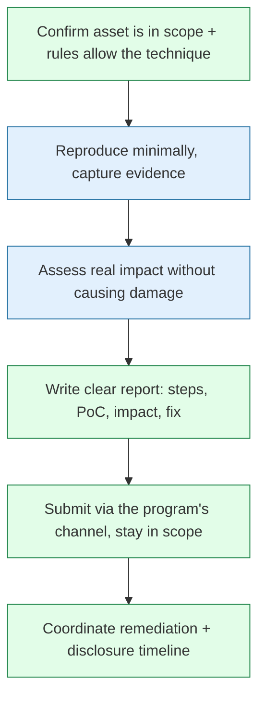

# Bug Bounty Programs and Vulnerability Reporting

## Summary

Finding a vulnerability is only half the work; the value is realised when it is **reported clearly and handled responsibly**. A bug bounty program is a formal invitation from an organisation for researchers to test in-scope systems and report flaws, usually for recognition or payment, under defined rules. The defining constraint is the same as all security testing: stay inside the authorised scope and rules. A good report reproduces the issue, shows real impact without causing damage, and gives the defender enough to fix it. This is a process and disclosure topic, so no ATT&CK technique maps to it.

## How a program defines the game

| Element | What it sets |
|---|---|
| **Scope** | Exactly which domains, apps, APIs and assets may be tested (and which are off-limits) |
| **Rules of engagement** | Allowed techniques; bans on DoS, social engineering, data exfiltration, automated flooding |
| **Safe harbour** | A commitment not to pursue legal action for good-faith testing within the rules |
| **Severity/reward** | How impact is rated (often CVSS) and what, if anything, is paid |
| **Disclosure policy** | Whether and when findings may be made public |

Testing outside scope or against a target with no program is not authorised and can be illegal, regardless of intent.

## Reporting workflow

## What a good report contains

- **Clear title and summary**: the vulnerability class and the affected asset.
- **Exact reproduction steps**: request/response, parameters, and preconditions, so a defender reproduces it first try.
- **Proof of concept**: the minimal demonstration of the flaw; never a destructive or data-stealing payload.
- **Impact**: what an attacker gains, stated concretely, with a severity rating (CVSS is common).
- **Remediation guidance**: the underlying cause and how to fix it.
- **Scope compliance**: confirmation the testing stayed within the authorised boundary.

## Responsible disclosure principles

- **Minimise harm**: prove the bug with the least access needed; do not pivot, exfiltrate data, or degrade service.
- **Report privately first** and give the organisation reasonable time to fix before any public disclosure.
- **Respect scope and law**: no program does not mean permission; use the organisation's disclosure channel or a coordinated process.
- **For organisations**: publish a clear vulnerability disclosure policy and a reporting channel so researchers can report safely — the absence of one pushes findings underground.

## ATT&CK mapping

No ATT&CK technique; this is an authorised testing and disclosure process, not an attack.

## Explanation

A bug bounty is a sign on the building saying "please test these specific doors, here are the rules, and we won't call the police if you play fair." Finding the open door matters little unless you hand the owner a clear note: which door, how you opened it, what it leads to, and how to fit a better lock — without rummaging through the rooms inside. Good reporting and responsible disclosure are what turn a found flaw into a fixed one instead of a breach.
