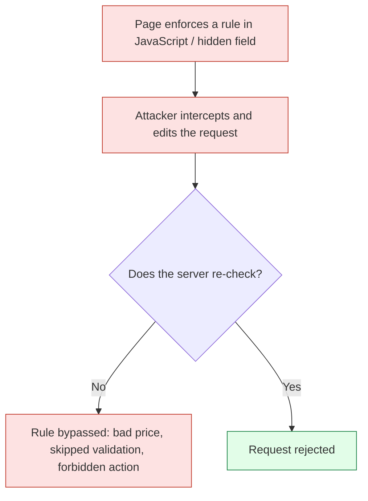

# Client-Side Control Bypass

## Summary

A client-side control is any security or validation logic that runs in the browser: JavaScript input validation, disabled form fields, hidden fields, price or quantity set in the page, or checks in a mobile/SPA front end. The attacker fully controls their own browser and the requests it sends, so **any control enforced only on the client can be bypassed** (CWE-602). Client-side controls are for usability; the server must re-enforce everything that matters.

## How it works

The attacker does not play by the page's rules. They can:

- Edit requests in an intercepting proxy (Burp, ZAP) before they reach the server.
- Change hidden fields, disabled inputs, prices, quantities, or role flags.
- Remove or alter JavaScript validation, or call the API directly, skipping the UI entirely.
- Replay and modify requests the SPA or mobile app would normally send.

Anything the server trusts because "the page wouldn't send that" is exploitable: negative quantities, client-set prices, skipped validation, actions the UI hid but the endpoint still accepts.

## Attack flow

## Detection

- Requests carrying values the UI should make impossible (negative amounts, altered prices, fields set to privileged values).
- API calls that never pass through the normal UI sequence.
- Testing: intercept and tamper with every client-set value and confirm the server rejects invalid ones.

## Defense

- **Re-validate and re-authorize on the server** for every request. Treat all client input as untrusted, including hidden fields, disabled inputs and values the page itself set.
- **Never trust client-set security-relevant values** such as prices, totals, discounts, user IDs or roles; derive them on the server from authoritative data.
- Keep client-side validation for user experience, but mirror it server-side as the real control.
- Apply server-side authorization (see [Broken Access Control](broken-access-control.md)).

## ATT&CK mapping

No single ATT&CK technique applies; this is a foundational web-security principle underlying many web exploits.

## Explanation

The browser is the attacker's own home turf, so any rule written only in the page is a suggestion they can ignore. Asking the browser to enforce security is like asking customers to tally their own bill on the honour system: fine for convenience, useless as the real control. The cash register (the server) has to add it up again, every time.
