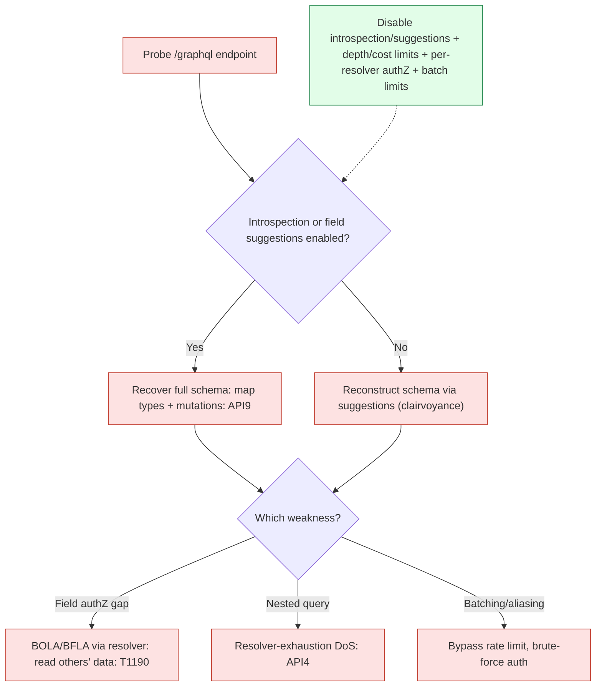

# GraphQL API Security

## Summary

GraphQL exposes a **single endpoint** (typically `/graphql`) through which clients request exactly the fields they want via a typed schema. That flexibility shifts the security burden: a server that lets the client shape arbitrary queries must still enforce **authorization per field and per object**, limit **query cost**, and avoid **leaking its schema**. The common GraphQL-specific issues are introspection exposure, nested/recursive query denial of service, batching to bypass rate limits and brute-force defences, and field-level authorization gaps. The underlying risks still map to the OWASP API Security Top 10; this file details the GraphQL mechanics and the defences, from the defender's view.

## GraphQL-specific issues

- **Introspection exposure.** GraphQL's introspection query (`__schema`, `__type`) returns the entire schema — every type, field and mutation. Left enabled in production it hands an attacker a complete map of the API (reconnaissance; OWASP API9 Improper Inventory Management). Tools like **graphw00f** fingerprint the engine and **clairvoyance** can reconstruct a schema even when introspection is disabled, by abusing field-suggestion error messages.
- **Field suggestions.** Many engines reply to a mistyped field with "Did you mean `xyz`?" — leaking valid field names even without introspection. Disable suggestions in production.
- **Nested / recursive query DoS.** Related types can be queried in a deeply nested loop (e.g. `author → posts → author → posts …`), producing an exponential resolver workload from a tiny request — an OWASP API4 (Unrestricted Resource Consumption) denial of service.
- **Query batching abuse.** Sending an **array of operations** (or aliasing the same mutation many times in one document) runs many operations in a single HTTP request, defeating per-request rate limits and enabling fast credential brute-forcing or 2FA/OTP guessing.
- **Authorization gaps (BOLA/BFLA at field level).** Because one query can traverse many objects and relationships, an authorization check missing on a single resolver exposes data reachable through that field, even if the top-level query was authorized. This is OWASP API1/API5 expressed through the graph.
- **Injection through arguments.** Resolver arguments flow into databases and services; GraphQL does not prevent SQL/NoSQL/command injection.

## Flow

## Detection

- **Introspection queries in production** (`__schema`/`__type` in request bodies) — almost always reconnaissance.
- **High-depth or high-alias queries**, or very large single documents — resource-consumption or batching abuse.
- **Batched operation arrays** hitting authentication/OTP mutations repeatedly from one client — brute-force via batching.
- A burst of **field-suggestion errors** (invalid field names), the signature of schema reconstruction tools.
- One session resolving objects across many owners through relationship fields (field-level BOLA).

## Defense

- **Disable introspection and field suggestions** in production (or restrict to authenticated/privileged clients).
- **Enforce query depth, complexity/cost, and node-count limits**; set timeouts on resolvers.
- **Limit or disable query batching**, and apply rate limits that count operations, not just HTTP requests.
- **Authorize in every resolver** — check object ownership and role at the field level, not only at the top-level query/mutation.
- **Validate and parameterise** all resolver arguments against injection.
- **Use persisted/allow-listed queries** for first-party clients so only known operations are accepted.

## ATT&CK mapping

| ID | Name | Tactic |
|---|---|---|
| T1190 | Exploit Public-Facing Application | Initial Access |
| T1078 | Valid Accounts | Initial Access, Persistence, Privilege Escalation, Defense Evasion |

## Explanation

A GraphQL API is like a library with one very helpful front desk: instead of fixed forms, you write out exactly which books and which pages you want, and the desk fetches precisely that. The convenience is also the danger. If the desk will happily describe its entire catalogue when asked (introspection), an attacker gets a perfect map. If it will follow a request that loops "the author of this book, and their books, and those authors…" forever, one slip of paper can exhaust the whole staff. If it lets you staple a thousand requests together on one slip, it can't count how many password guesses you just made. And because a single request can wander deep into the shelves through related records, the desk has to check your permission at every shelf it visits, not just at the door. Lock the catalogue, cap how deep and how wide a request may go, count operations rather than slips, and check permission at every step.
