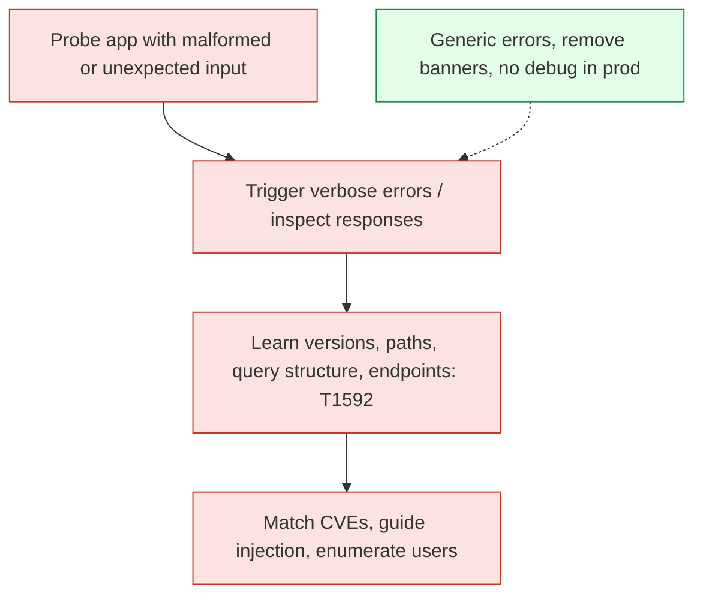

# Information Disclosure and Error Handling Exploitation

## Summary

Information disclosure is when an application reveals data that helps an attacker, either about the system (versions, paths, stack traces, configuration) or about users (CWE-200). Verbose error handling is a common source: a stack trace or database error can hand over the exact technology, file paths and query structure an attacker needs. Individually minor, these leaks shorten the path to a real exploit.

## What leaks, and why it matters

| Leak | What the attacker gains |
|---|---|
| Stack traces / debug errors | Framework and library versions, file paths, internal logic, sometimes secrets (CWE-209) |
| Database errors | Query structure and column names, confirming and guiding SQL injection |
| Verbose headers (`Server`, `X-Powered-By`, version banners) | Exact software and version to match against known CVEs |
| Comments and metadata in responses | Internal hostnames, credentials, TODO notes, hidden endpoints |
| Directory listing / backup files (`.bak`, `.git`, `.env`) | Source code, configuration and secrets |
| Default pages / error codes | Technology fingerprint; 403 vs 404 differences reveal what exists |
| User data in responses or messages | Enumeration (which accounts/emails exist) |

These feed the reconnaissance stage (gathering victim host and identity information, ATT&CK T1592 / T1589) and sharpen later attacks.

## Attack flow

## Detection

- Responses containing stack traces, database errors, internal paths or version banners.
- Requests probing for backup/config files (`.git/`, `.env`, `*.bak`, `web.config`).
- Scanners fingerprinting the stack via error-code and header differences.

## Defense

- **Generic error pages** for users; log the detail server-side only. Never show stack traces or database errors in production (CWE-209).
- **Disable debug mode** in production.
- **Strip or genericise version banners** (`Server`, `X-Powered-By`) and remove sensitive comments/metadata from responses.
- **Disable directory listing**; block access to source control, backup and environment files.
- **Return uniform responses** for authentication and resource existence so attackers cannot enumerate users or valid IDs by differences.
- Treat small leaks seriously: they compound into targeted exploits.

## ATT&CK mapping

| ID | Name | Tactic |
|---|---|---|
| T1592 | Gather Victim Host Information | Reconnaissance |
| T1589 | Gather Victim Identity Information | Reconnaissance |

## Explanation

Every verbose error is the application introducing itself to the attacker: its name, version, where it keeps its files, and how its queries are shaped. None of that is an exploit on its own, but it turns guesswork into a targeted plan. The fix is to be polite but uninformative to strangers: a plain "something went wrong" to the user, and the real details kept in the logs.
