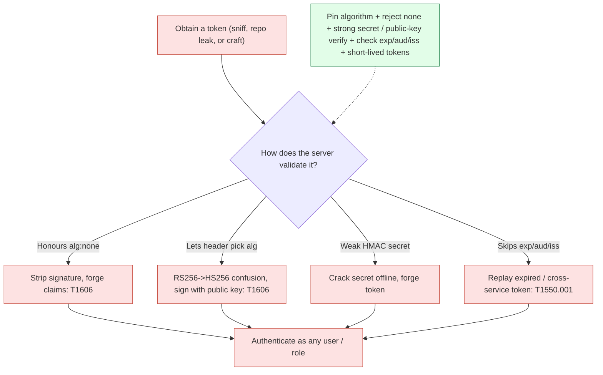

# JWT and API Token Security

## Summary

APIs authenticate callers with **bearer tokens** — most often **JSON Web Tokens (JWTs)**, plus API keys and OAuth2 access tokens. A JWT is a signed (sometimes encrypted) statement of claims the server trusts without a database lookup, which makes **how the server validates it** the whole game. The recurring failures are accepting unsigned tokens (`alg:none`), algorithm confusion (RS256→HS256), weak or guessable HMAC secrets, not checking `exp`/`aud`/`iss`, and treating a token as proof of authorization rather than only authentication. This maps to OWASP API2:2023 (Broken Authentication). The framing here is defensive: how each flaw works and the validation rules that close it.

## How JWT validation fails

- **`alg: none`.** An attacker changes the header algorithm to `none` and strips the signature. A server that honours the header accepts a forged, unsigned token — ATT&CK T1606 (Forge Web Credentials). Reject `none` outright.
- **Algorithm confusion (RS256 → HS256).** The token should be verified with the RSA **public** key under RS256. If the server naively verifies with "the key" and the attacker switches the header to HS256, the server may use the **public key as the HMAC secret** — which is public — letting the attacker sign tokens. Pin the expected algorithm server-side; never let the token's header choose it.
- **Weak HMAC secret.** HS256 tokens signed with a guessable secret can be cracked offline (e.g. with `hashcat`/`jwt_tool`) and then forged. Use long, random secrets.
- **Missing claim checks.** Not validating `exp` (expiry), `nbf`, `aud` (intended audience) or `iss` (issuer) lets expired or cross-service tokens be replayed. A token for service A accepted by service B is a classic break.
- **`kid`/`jku`/`x5u` abuse.** Injecting a header that points signing-key lookup at an attacker-controlled key or URL, or SQL/path injection through `kid`. Treat these headers as untrusted.
- **No revocation.** Long-lived, non-revocable access tokens mean a stolen token (T1528 Steal Application Access Token) works until expiry. Keep access tokens short and use refresh tokens with revocation.

## API keys and OAuth2

- **API keys** identify a project, not a user, and often carry broad scope. Leaked keys (in repos, mobile apps, JS) grant whatever the key allows — scope them tightly and rotate.
- **OAuth2 access tokens** are bearer tokens: anyone holding one can use it (T1550.001 Use Alternate Authentication Material: Application Access Token). Over-broad **scopes**, missing audience binding, and tokens logged or cached in transit are the common weaknesses.

## Flow

## Detection

- Tokens presented with `alg: none` or an unexpected algorithm — a validating server should log and reject these.
- Tokens failing signature, `exp`, `aud` or `iss` checks in volume (forging/replay attempts).
- The same token used from many IPs/user-agents at once (sharing/theft), or a token used after the user's session should have ended.
- `kid`/`jku` header values containing URLs, paths or SQL metacharacters.
- OAuth tokens used far outside their granted scope or expected client.

## Defense

- **Pin the accepted algorithm(s) server-side**; never trust the token header to select it. **Reject `alg: none`.**
- **Verify correctly**: RSA public key for RS256; a long, random secret for HS256.
- **Validate `exp`, `nbf`, `aud` and `iss`** on every request, and bind tokens to their intended audience.
- **Keep access tokens short-lived** with refresh + revocation; support logout/compromise revocation.
- **Treat `kid`/`jku`/`x5u` as untrusted input**; restrict key sources to an allow-list.
- **Scope API keys and OAuth tokens narrowly**, keep them out of URLs/logs/repos, and rotate on exposure.
- Follow **RFC 8725 (JWT Best Current Practices)** and remember: a valid token proves *who*, not *what they may do* — still authorize each request.

## ATT&CK mapping

| ID | Name | Tactic |
|---|---|---|
| T1528 | Steal Application Access Token | Credential Access |
| T1550.001 | Use Alternate Authentication Material: Application Access Token | Defense Evasion, Lateral Movement |
| T1606 | Forge Web Credentials | Credential Access |

## Explanation

A JWT is a tamper-proof wristband the server hands you at the door: it says who you are, and the server trusts it on sight so it doesn't have to re-check a guest list every time. The whole scheme rests on the server actually checking the wristband's seal properly. The famous failures are all variations of the bouncer getting lazy: accepting a wristband with the seal torn off (`alg:none`), being tricked into checking the seal with a stamp everyone can buy (RS256→HS256 confusion), using a seal so simple it can be forged (weak secret), or not noticing the wristband expired or was issued for a different club (missing `exp`/`aud` checks). Fix it by deciding in advance exactly which seal is valid, refusing torn ones, keeping the stamp secret and the wristbands short-lived — and remembering that a genuine wristband only proves you're a guest, not that you're allowed into the VIP room.
