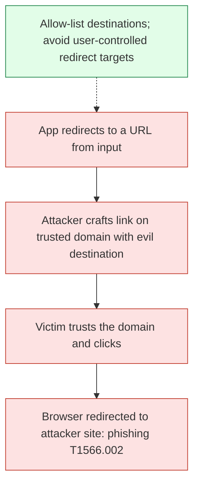

# Open Redirects

## Summary

An open redirect (unvalidated redirect) is when a web application takes a destination URL from untrusted input and redirects the browser there without checking it (CWE-601). Because the link starts on the trusted site's domain, it lends an attacker's phishing or malware link a trustworthy appearance. Open redirects are also used to bypass flawed access checks and to help steal OAuth tokens.

## How it works

A URL like:
```
https://trusted.site/login?next=https://evil.example/fake-login
```
If the app redirects to whatever `next` contains after login, the victim ends up on the attacker's page while the link they clicked was on `trusted.site`. OWASP notes the server name in the link is identical to the real site, so the phishing attempt looks more legitimate.

Uses:
- **Phishing** (ATT&CK T1566.002, Spearphishing Link): a convincing link on a real domain that lands on an attacker page.
- **Filter/ACL bypass**: crafting a URL that passes an access check and then forwards to a privileged or external destination.
- **Token theft**: abusing a loose redirect/`redirect_uri` in OAuth/SSO flows to send authorization codes or tokens to the attacker.

## Attack flow



## Detection

- Redirect endpoints whose target comes from a request parameter without validation.
- Logs showing redirects to external domains from parameters like `next`, `url`, `return`, `redirect`, `dest`.
- In OAuth flows, `redirect_uri` values that are not strictly matched.

## Defense

Per OWASP:

- **Avoid redirects/forwards driven by user input** where possible.
- If a destination must be chosen by input, **map it to an allow-list** of known-safe URLs or use indirect identifiers the server resolves, rather than redirecting to the raw value.
- If arbitrary redirects are a genuine requirement, validate that the target is within your own domain(s), and consider an interstitial page warning the user they are leaving the site.
- For OAuth/SSO, **strictly match `redirect_uri`** against pre-registered exact values.

## ATT&CK mapping

| ID | Name | Tactic |
|---|---|---|
| T1566.002 | Phishing: Spearphishing Link | Initial Access |

## Explanation

An open redirect lets an attacker borrow your front door. The visitor sees your trusted address on the link, walks through your doorway, and is quietly ushered out a back exit onto the attacker's property. The fix is to only ever forward visitors to rooms on a list you control, never to wherever the link's fine print says.
